<div align="center">

# Uplift

### An AI growth team for Shopify and Google Ads, paid through Cardano escrow and released only for proven work.

**Thirteen AI agents, each with its own identity on Cardano. They optimize a merchant's Shopify listing (keywords,
copy, photos, pricing, catalog, translations, compliance) and build its Google Ads campaigns. Merchants hire them on
Sokosumi, every payment is locked in Masumi escrow on Cardano, and Chainlink CRE verifies the work before a single
change goes live or a single unit is released.**


</div>

---

> **The problem, in one breath.** Every day thousands of small merchants list a product on Shopify with a one-line
> description, a phone photo and a guessed price. Then they pour money into Google Ads that send shoppers to that page.
> A growth agency costs thousands a month. AI tools are cheap, but they hallucinate claims, overwrite good copy and
> charge whether the work is good or not. Nobody can prove what an AI did to their store, or that they only paid for
> work that held up.

---

## Important links

| Resource | Link |
|---|---|
| **Demo video** | _(add link)_ |
| **Pitch deck** | _(add link)_ |
| Hire the team on Sokosumi (preprod) | [preprod.sokosumi.com/agents](https://preprod.sokosumi.com/agents) |
| `/live`: watch a Task run, with its Cardano escrow | _(add link to the landing `/live` page)_ |
| Google Ads mock (shows a finished run's real campaigns) | [ads-mock-production.up.railway.app](https://ads-mock-production.up.railway.app) |
| Masumi escrow contract (Cardano preprod) | [`addr_test1wzs4e6wc…ftgn37w4g`](https://preprod.cexplorer.io/address/addr_test1wzs4e6wc95hkwezlccjw9mdvq0r0rsgx6zk34avptga3ftgn37w4g) |
| Masumi registry policy (agent identity NFTs) | [`67ab0c92…23b3bd0b`](https://preprod.cexplorer.io/policy/67ab0c92c4ac1610895a1c965ee50aba41a8f1513b15240723b3bd0b) |
| Recorded end-to-end test: 19 Tasks with briefs, receipts, verdicts and deliverables | [`runs/`](runs/README.md) |

---

<a id="important-transactions"></a>

## Important transactions

Everything below is **live on Cardano preprod**. Click any hash to see it on the explorer. The list was pulled from
Uplift's own Masumi payment node with [`e2e/payments.py`](e2e/payments.py), which anyone with node access can re-run.

### At a glance

|  | |
|---|---|
| Agents registered on-chain (Masumi registry NFTs) | **13**, minted in **5** transactions |
| Paid Tasks escrowed on Cardano | **43** escrows in **45** unique transactions |
| Escrows settled with an on-chain result hash (`ResultSubmitted`) | **35**, for **96 tUSDM** of work |
| Escrows refunded on-chain to the buyer (`RefundWithdrawn`) | **8**, for **13.5 tUSDM**: declined or duplicate work, never charged |
| Escrow locks batched into one transaction | **43 locks → 16 transactions** (Masumi batches escrows) |
| Settlement token | tUSDM, unit `16a55b2a349361ff88c03788f93e1e966e5d689605d044fef722ddde` + `0014df10745553444d` (Sokosumi charges 100 workspace credits per tUSDM) |

### 1. Agent identities: 13 registry NFTs

Each Uplift agent is an NFT on the Masumi registry. Its **agent identifier** is the policy ID plus the asset name.
Sokosumi's buyer node resolves this identifier on-chain before it pays anyone.
Registration code: [`infra/masumi/register.py`](infra/masumi/register.py#L54-L123).

| Agent | On-chain name | Pricing | Agent identifier (registry NFT) | Registration tx |
|---|---|---|---|---|
| **Nora** | Nora · Uplift Lead | Dynamic | `67ab0c92c4ac1610895a1c965ee50aba41a8f1513b15240723b3bd0b`<br>`10a25d831d39ec7f27848e0345b67e6fc02e29b012b7c738dad13640b2000000` | [`db8ccb77a327…`](https://preprod.cexplorer.io/tx/db8ccb77a3271aa198176e37056201db2209740e3373ccdfa53e54c919cfa80a) |
| **Quinn** | Quinn · Store Auditor & Performance Analyst | Fixed | `67ab0c92c4ac1610895a1c965ee50aba41a8f1513b15240723b3bd0b`<br>`1044ed928f2f7b5f594e459a466fcf14175ccf1cdccca8dba94a8651a8000000` | [`2c67ee40a2ef…`](https://preprod.cexplorer.io/tx/2c67ee40a2ef1c228901114e9a85ba9c1b6c2c7c0e7405a274b1e95f3dfd952b) |
| **Kai** | Kai · Search Demand Analyst | Fixed | `67ab0c92c4ac1610895a1c965ee50aba41a8f1513b15240723b3bd0b`<br>`10f71ca2d55720eb2acf6dc10ae58de909bcbf006fe60677f5000ecb36000000` | [`fe24c028130b…`](https://preprod.cexplorer.io/tx/fe24c028130b3b64cfcd9123e91f9818bd8d1ba223dd1fb1cace74618729a3c1) |
| **Rafael** | Rafael · Competitor & Market Analyst | Fixed | `67ab0c92c4ac1610895a1c965ee50aba41a8f1513b15240723b3bd0b`<br>`11f71ca2d55720eb2acf6dc10ae58de909bcbf006fe60677f5000ecb36000000` | [`fe24c028130b…`](https://preprod.cexplorer.io/tx/fe24c028130b3b64cfcd9123e91f9818bd8d1ba223dd1fb1cace74618729a3c1) |
| **Priya** | Priya · Competitor Review & Sentiment Analyst | Fixed | `67ab0c92c4ac1610895a1c965ee50aba41a8f1513b15240723b3bd0b`<br>`12f71ca2d55720eb2acf6dc10ae58de909bcbf006fe60677f5000ecb36000000` | [`fe24c028130b…`](https://preprod.cexplorer.io/tx/fe24c028130b3b64cfcd9123e91f9818bd8d1ba223dd1fb1cace74618729a3c1) |
| **Marcus** | Marcus · Pricing & Promotions Strategist | Fixed | `67ab0c92c4ac1610895a1c965ee50aba41a8f1513b15240723b3bd0b`<br>`13f71ca2d55720eb2acf6dc10ae58de909bcbf006fe60677f5000ecb36000000` | [`fe24c028130b…`](https://preprod.cexplorer.io/tx/fe24c028130b3b64cfcd9123e91f9818bd8d1ba223dd1fb1cace74618729a3c1) |
| **Clara** | Clara · Product Page Copywriter | Fixed | `67ab0c92c4ac1610895a1c965ee50aba41a8f1513b15240723b3bd0b`<br>`14f71ca2d55720eb2acf6dc10ae58de909bcbf006fe60677f5000ecb36000000` | [`fe24c028130b…`](https://preprod.cexplorer.io/tx/fe24c028130b3b64cfcd9123e91f9818bd8d1ba223dd1fb1cace74618729a3c1) |
| **Iris** | Iris · Product Visual Designer | Fixed | `67ab0c92c4ac1610895a1c965ee50aba41a8f1513b15240723b3bd0b`<br>`10c686f3f1b36ef23ace7bee4013fa6d3ebebaa001ff6189e3b1b48df1000000` | [`b1d9580ffede…`](https://preprod.cexplorer.io/tx/b1d9580ffede726e85fb1592fb8bf055d9d5bc599e0f1543663c87074d73d790) |
| **Oskar** | Oskar · Catalog, Collections & Shopping Feed Specialist | Fixed | `67ab0c92c4ac1610895a1c965ee50aba41a8f1513b15240723b3bd0b`<br>`11c686f3f1b36ef23ace7bee4013fa6d3ebebaa001ff6189e3b1b48df1000000` | [`b1d9580ffede…`](https://preprod.cexplorer.io/tx/b1d9580ffede726e85fb1592fb8bf055d9d5bc599e0f1543663c87074d73d790) |
| **Leo** | Leo · Content & Email Marketer | Fixed | `67ab0c92c4ac1610895a1c965ee50aba41a8f1513b15240723b3bd0b`<br>`13c686f3f1b36ef23ace7bee4013fa6d3ebebaa001ff6189e3b1b48df1000000` | [`b1d9580ffede…`](https://preprod.cexplorer.io/tx/b1d9580ffede726e85fb1592fb8bf055d9d5bc599e0f1543663c87074d73d790) |
| **Sasha** | Sasha · Paid Ads Strategist | Fixed | `67ab0c92c4ac1610895a1c965ee50aba41a8f1513b15240723b3bd0b`<br>`10ce2888b7f1611846a955e462f0ca293c6577a2a0ccc622897fd75413000000` | [`6ab715b814db…`](https://preprod.cexplorer.io/tx/6ab715b814db9835d748aa5fbe07c9919ea59f80d582f57079779944f2eacb58) |
| **Yuki** | Yuki · Localization & Transcreation Specialist | Fixed | `67ab0c92c4ac1610895a1c965ee50aba41a8f1513b15240723b3bd0b`<br>`12c686f3f1b36ef23ace7bee4013fa6d3ebebaa001ff6189e3b1b48df1000000` | [`b1d9580ffede…`](https://preprod.cexplorer.io/tx/b1d9580ffede726e85fb1592fb8bf055d9d5bc599e0f1543663c87074d73d790) |
| **Ruth** | Ruth · Claims & Compliance Reviewer | Fixed | `67ab0c92c4ac1610895a1c965ee50aba41a8f1513b15240723b3bd0b`<br>`14c686f3f1b36ef23ace7bee4013fa6d3ebebaa001ff6189e3b1b48df1000000` | [`b1d9580ffede…`](https://preprod.cexplorer.io/tx/b1d9580ffede726e85fb1592fb8bf055d9d5bc599e0f1543663c87074d73d790) |

### 2. Every escrow, oldest first

Each paid Task leaves two transactions:

- **FundsLocked.** Sokosumi's buyer node locks the merchant's credits as tUSDM in the Masumi escrow contract.
- **ResultSubmitted.** Uplift writes the hash of the Chainlink-verified deliverable into the escrow datum.

When no result is ever submitted (the merchant declined, or the run was a duplicate), the escrow pays the buyer back
instead (**RefundWithdrawn**). Several escrows often share one transaction because the payment node batches them.
Tasks marked with a link have a full recorded run in [`runs/`](runs/README.md).

<details open>
<summary><b>All 43 escrows and their transactions</b></summary>

| # | Locked at (UTC) | Task | tUSDM | FundsLocked | Settlement |
|---|---|---|---|---|---|
| 1 | 10-07 01:58 | Task `01a11415…1ed0` | 0.25 | [`c9014adf88bf…`](https://preprod.cexplorer.io/tx/c9014adf88bfbac81ca3abbca6258571149e9eadf4c29d4a5ea99b3af4132448) |  ResultSubmitted [`994b8bef115d…`](https://preprod.cexplorer.io/tx/994b8bef115deeb7cd9f64fbc13219965a3a5caa185c22ec15255f3af94ec5a8) |
| 2 | 10-07 02:05 | Task `01a1141b…72f1` | 0.5 | [`d3463d4737fd…`](https://preprod.cexplorer.io/tx/d3463d4737fd6c60ec59f8d59150c4eb91c1d30d9dae3d359eb0bed0bb52da6f) |  ResultSubmitted [`4c747a2a7341…`](https://preprod.cexplorer.io/tx/4c747a2a73418b97a267fabb9f0e5988d64b472e19a68846bd308948e5b03781) |
| 3 | 10-07 02:05 | Task `01a1141b…bd8f` | 1.25 | [`d3463d4737fd…`](https://preprod.cexplorer.io/tx/d3463d4737fd6c60ec59f8d59150c4eb91c1d30d9dae3d359eb0bed0bb52da6f) |  ResultSubmitted [`4c747a2a7341…`](https://preprod.cexplorer.io/tx/4c747a2a73418b97a267fabb9f0e5988d64b472e19a68846bd308948e5b03781) |
| 4 | 10-07 02:05 | Task `01a1141b…9a66` | 1.25 | [`d3463d4737fd…`](https://preprod.cexplorer.io/tx/d3463d4737fd6c60ec59f8d59150c4eb91c1d30d9dae3d359eb0bed0bb52da6f) |  ResultSubmitted [`1c4e67d058f6…`](https://preprod.cexplorer.io/tx/1c4e67d058f6acede9113e136cd4e277dfa0204425d8baa6797fe9c20c8f9ec4) |
| 5 | 10-07 02:05 | Task `01a1141b…9363` | 1.25 | [`d3463d4737fd…`](https://preprod.cexplorer.io/tx/d3463d4737fd6c60ec59f8d59150c4eb91c1d30d9dae3d359eb0bed0bb52da6f) |  ResultSubmitted [`ba1abfc91552…`](https://preprod.cexplorer.io/tx/ba1abfc915527ff384c556c3d98154960b15e8b56a543ebed4c2dd511b2c99b7) |
| 6 | 10-07 02:05 | Task `01a1141b…dbb9` | 2 | [`d3463d4737fd…`](https://preprod.cexplorer.io/tx/d3463d4737fd6c60ec59f8d59150c4eb91c1d30d9dae3d359eb0bed0bb52da6f) |  ResultSubmitted [`ba1abfc91552…`](https://preprod.cexplorer.io/tx/ba1abfc915527ff384c556c3d98154960b15e8b56a543ebed4c2dd511b2c99b7) |
| 7 | 10-07 02:05 | Task `01a1141b…caf6` | 1.5 | [`d3463d4737fd…`](https://preprod.cexplorer.io/tx/d3463d4737fd6c60ec59f8d59150c4eb91c1d30d9dae3d359eb0bed0bb52da6f) |  RefundWithdrawn [`df5bb676fbf5…`](https://preprod.cexplorer.io/tx/df5bb676fbf57128671ce954a6c921d3787d7200b123aa5603a7e9d388a76642) |
| 8 | 10-07 02:09 | Task `01a1141f…32fd` | 1 | [`da221aaf6bc6…`](https://preprod.cexplorer.io/tx/da221aaf6bc6db4e5785893a7277a3bfb741c78ffcbb56a22fb816fe46a17fb8) |  ResultSubmitted [`381c072f2202…`](https://preprod.cexplorer.io/tx/381c072f22021381ae541f3f72d13e971b94e220072ea554c77a78652ec65a00) |
| 9 | 10-07 02:20 | Task `01a11429…c2b5` | 1.25 | [`6a95b180a71b…`](https://preprod.cexplorer.io/tx/6a95b180a71b15ce99b1392e5a9673c7931e60611e07886f6c97cf9d1c48076c) |  ResultSubmitted [`84a32d12de81…`](https://preprod.cexplorer.io/tx/84a32d12de81a5402867d41486d637a04d3ad3009cb8e160ce656713e39c601f) |
| 10 | 10-07 02:20 | Task `01a11429…0fec` | 2.5 | [`6a95b180a71b…`](https://preprod.cexplorer.io/tx/6a95b180a71b15ce99b1392e5a9673c7931e60611e07886f6c97cf9d1c48076c) |  ResultSubmitted [`2f3e4441802a…`](https://preprod.cexplorer.io/tx/2f3e4441802a58ca81b12466958a0c543cc89a5be60089e356ea45f495f449f6) |
| 11 | 10-07 02:20 | Task `01a11429…4b7a` | 1.5 | [`6a95b180a71b…`](https://preprod.cexplorer.io/tx/6a95b180a71b15ce99b1392e5a9673c7931e60611e07886f6c97cf9d1c48076c) |  ResultSubmitted [`aca00b500f03…`](https://preprod.cexplorer.io/tx/aca00b500f0314b87add6519e4bcf6d0a5508b59cb131385ccb674a084ae2da8) |
| 12 | 10-07 02:20 | Task `01a11429…a00f` | 1.5 | [`6a95b180a71b…`](https://preprod.cexplorer.io/tx/6a95b180a71b15ce99b1392e5a9673c7931e60611e07886f6c97cf9d1c48076c) |  ResultSubmitted [`84a32d12de81…`](https://preprod.cexplorer.io/tx/84a32d12de81a5402867d41486d637a04d3ad3009cb8e160ce656713e39c601f) |
| 13 | 10-07 02:20 | Task `01a11429…36d2` | 1.5 | [`6a95b180a71b…`](https://preprod.cexplorer.io/tx/6a95b180a71b15ce99b1392e5a9673c7931e60611e07886f6c97cf9d1c48076c) |  ResultSubmitted [`2f3e4441802a…`](https://preprod.cexplorer.io/tx/2f3e4441802a58ca81b12466958a0c543cc89a5be60089e356ea45f495f449f6) |
| 14 | 10-07 02:20 | Task `01a11429…e08e` | 2 | [`6a95b180a71b…`](https://preprod.cexplorer.io/tx/6a95b180a71b15ce99b1392e5a9673c7931e60611e07886f6c97cf9d1c48076c) |  ResultSubmitted [`2f3e4441802a…`](https://preprod.cexplorer.io/tx/2f3e4441802a58ca81b12466958a0c543cc89a5be60089e356ea45f495f449f6) |
| 15 | 10-07 02:20 | Task `01a11429…b8ae` | 2 | [`6a95b180a71b…`](https://preprod.cexplorer.io/tx/6a95b180a71b15ce99b1392e5a9673c7931e60611e07886f6c97cf9d1c48076c) |  ResultSubmitted [`15cef4971309…`](https://preprod.cexplorer.io/tx/15cef49713092834d5a16118e7501bb8d3f6b90519d0042d8c1471f02f5a73d3) |
| 16 | 10-07 03:23 | Task `01a1145a…20f6` | 1 | [`08e84e6c7cf0…`](https://preprod.cexplorer.io/tx/08e84e6c7cf037b8fe40f4221c376fb821745f3481c174dbd470c4fd4450284e) |  ResultSubmitted [`4eb67ab420e9…`](https://preprod.cexplorer.io/tx/4eb67ab420e910965f5365f6b046954ca8f4181ecc7b67254986de11f08fe497) |
| 17 | 10-07 03:39 | [Polish my glass bottle page](runs/00-nora-glass-bottle/README.md) | 7.25 | [`2288fd5a1716…`](https://preprod.cexplorer.io/tx/2288fd5a171646d5fe8745c487a46df93b70d90c4b7c283fcbee4ff6d786c39b) |  ResultSubmitted [`f04f5d41f508…`](https://preprod.cexplorer.io/tx/f04f5d41f5086b6b2ba345b0f5bf80b1f49ed0c96f75e28340c067e2b83dfba3) |
| 18 | 10-07 03:44 | [What do shoppers dislike about rival travel tumblers?](runs/tumbler/04-priya/README.md) | 1.5 | [`24816fbdde55…`](https://preprod.cexplorer.io/tx/24816fbdde55e00784b06a508ff01a78086b8468690a251aa2ced6ae6e5917f8) |  ResultSubmitted [`dcbdf50cf95a…`](https://preprod.cexplorer.io/tx/dcbdf50cf95a17b66d4304425ed8e528e5d8cbf253b84ed571b4f816e025a4bf) |
| 19 | 10-07 03:44 | [Keyword research for my travel tumbler](runs/tumbler/02-kai/README.md) | 1.25 | [`24816fbdde55…`](https://preprod.cexplorer.io/tx/24816fbdde55e00784b06a508ff01a78086b8468690a251aa2ced6ae6e5917f8) |  ResultSubmitted [`0e2b99d2f4d6…`](https://preprod.cexplorer.io/tx/0e2b99d2f4d6fcaa8c3d0c085cdb48bb3faa3e45b8a135a6de983bf07999eb42) |
| 20 | 10-07 03:44 | [Launch pricing and promos for my travel tumbler](runs/tumbler/05a-marcus-declined/README.md) | 1.25 | [`24816fbdde55…`](https://preprod.cexplorer.io/tx/24816fbdde55e00784b06a508ff01a78086b8468690a251aa2ced6ae6e5917f8) |  RefundWithdrawn [`3a555c02c50e…`](https://preprod.cexplorer.io/tx/3a555c02c50ef458ebadec825e46880247ee984bf8041c41c8228475cb017f73) |
| 21 | 10-07 03:44 | [Competitor scan for my travel tumbler](runs/tumbler/03-rafael/README.md) | 1.25 | [`24816fbdde55…`](https://preprod.cexplorer.io/tx/24816fbdde55e00784b06a508ff01a78086b8468690a251aa2ced6ae6e5917f8) |  ResultSubmitted [`0e2b99d2f4d6…`](https://preprod.cexplorer.io/tx/0e2b99d2f4d6fcaa8c3d0c085cdb48bb3faa3e45b8a135a6de983bf07999eb42) |
| 22 | 10-07 03:44 | [Audit my travel tumbler listing](runs/tumbler/01-quinn-before/README.md) | 0.5 | [`24816fbdde55…`](https://preprod.cexplorer.io/tx/24816fbdde55e00784b06a508ff01a78086b8468690a251aa2ced6ae6e5917f8) |  ResultSubmitted [`0e2b99d2f4d6…`](https://preprod.cexplorer.io/tx/0e2b99d2f4d6fcaa8c3d0c085cdb48bb3faa3e45b8a135a6de983bf07999eb42) |
| 23 | 10-07 03:44 | [Google Ads plan for my travel tumbler](runs/tumbler/06-sasha/README.md) | 1.5 | [`24816fbdde55…`](https://preprod.cexplorer.io/tx/24816fbdde55e00784b06a508ff01a78086b8468690a251aa2ced6ae6e5917f8) |  ResultSubmitted [`0e2b99d2f4d6…`](https://preprod.cexplorer.io/tx/0e2b99d2f4d6fcaa8c3d0c085cdb48bb3faa3e45b8a135a6de983bf07999eb42) |
| 24 | 10-07 03:52 | [Product photos for my travel tumbler](runs/tumbler/08-iris/README.md) | 2.5 | [`fac952446f37…`](https://preprod.cexplorer.io/tx/fac952446f37ccc21cb0d2f5c2e56a817551fbe555c913211ddf3ed29c30504f) |  ResultSubmitted [`368baf8edc24…`](https://preprod.cexplorer.io/tx/368baf8edc2474e18c8b45262481bd16acb35912aaabefd6e4bdf86d01d170ab) |
| 25 | 10-07 03:52 | [Launch promos for my travel tumbler (new codes)](runs/tumbler/05b-marcus/README.md) | 1.25 | [`fac952446f37…`](https://preprod.cexplorer.io/tx/fac952446f37ccc21cb0d2f5c2e56a817551fbe555c913211ddf3ed29c30504f) |  ResultSubmitted [`368baf8edc24…`](https://preprod.cexplorer.io/tx/368baf8edc2474e18c8b45262481bd16acb35912aaabefd6e4bdf86d01d170ab) |
| 26 | 10-07 03:52 | [Catalog setup for my travel tumbler](runs/tumbler/09a-oskar-declined/README.md) | 1.5 | [`fac952446f37…`](https://preprod.cexplorer.io/tx/fac952446f37ccc21cb0d2f5c2e56a817551fbe555c913211ddf3ed29c30504f) |  RefundWithdrawn [`e2f35ff11e8c…`](https://preprod.cexplorer.io/tx/e2f35ff11e8ca92d80ffca62c54df5446215729c93d1cde90dd8e3ed5f42dfcf) |
| 27 | 10-07 03:52 | [FAQ and launch content for my travel tumbler](runs/tumbler/10-leo/README.md) | 2 | [`fac952446f37…`](https://preprod.cexplorer.io/tx/fac952446f37ccc21cb0d2f5c2e56a817551fbe555c913211ddf3ed29c30504f) |  ResultSubmitted [`368baf8edc24…`](https://preprod.cexplorer.io/tx/368baf8edc2474e18c8b45262481bd16acb35912aaabefd6e4bdf86d01d170ab) |
| 28 | 10-07 03:52 | [Rewrite my travel tumbler product page](runs/tumbler/07-clara/README.md) | 2 | [`fac952446f37…`](https://preprod.cexplorer.io/tx/fac952446f37ccc21cb0d2f5c2e56a817551fbe555c913211ddf3ed29c30504f) |  ResultSubmitted [`d1e08b8c260c…`](https://preprod.cexplorer.io/tx/d1e08b8c260ce0afb897ba400c1dea5ee8a1ff925134145d13eb2928eddbbf90) |
| 29 | 10-07 03:58 | [Compliance check of my travel tumbler page](runs/tumbler/11-ruth/README.md) | 0.25 | [`d3f27dd6c1c7…`](https://preprod.cexplorer.io/tx/d3f27dd6c1c7b9aa583caef662701b6031e385120b2af7b33e2bb7a1dd14856f) |  ResultSubmitted [`a723374f57bf…`](https://preprod.cexplorer.io/tx/a723374f57bfc507de294f4f9649e9766c1334c2bd3d4f4d45f64aa5f9ff0bbb) |
| 30 | 10-07 03:58 | [German version of my travel tumbler page](runs/tumbler/12-yuki/README.md) | 1 | [`d3f27dd6c1c7…`](https://preprod.cexplorer.io/tx/d3f27dd6c1c7b9aa583caef662701b6031e385120b2af7b33e2bb7a1dd14856f) |  ResultSubmitted [`fa5664b9591e…`](https://preprod.cexplorer.io/tx/fa5664b9591eefddcbeff1751fdc9192ea525341f63aa03da883f678c4685dfb) |
| 31 | 10-07 03:58 | [Catalog setup for my travel tumbler (retry)](runs/tumbler/09b-oskar/README.md) | 1.5 | [`d3f27dd6c1c7…`](https://preprod.cexplorer.io/tx/d3f27dd6c1c7b9aa583caef662701b6031e385120b2af7b33e2bb7a1dd14856f) |  ResultSubmitted [`fa5664b9591e…`](https://preprod.cexplorer.io/tx/fa5664b9591eefddcbeff1751fdc9192ea525341f63aa03da883f678c4685dfb) |
| 32 | 10-07 04:03 | [Re-audit my travel tumbler listing](runs/tumbler/13-quinn-after/README.md) | 0.5 | [`77e5622aae67…`](https://preprod.cexplorer.io/tx/77e5622aae672601ed604bb1b443aec422149c8cdf41dd1f851544b2a68b13f8) |  ResultSubmitted [`48ad5c09c479…`](https://preprod.cexplorer.io/tx/48ad5c09c479dd515e3075ee88034c715353a03004c32eea18babe97309a21b1) |
| 33 | 10-07 04:15 | [Launch promos for my travel tumbler (new codes)](runs/tumbler/duplicates/marcus/README.md) | 1.25 | [`b89e0053dacb…`](https://preprod.cexplorer.io/tx/b89e0053dacbaeec940ed6cb52a3fa4bbd74dc1c0c5e0fcbb6b8dc7b75288708) |  RefundWithdrawn [`bb9217486be7…`](https://preprod.cexplorer.io/tx/bb9217486be7eadb1628a7f41c1af2028deacd4181e6d4e52a194607b82b2534) |
| 34 | 10-07 04:15 | [Product photos for my travel tumbler](runs/tumbler/duplicates/iris/README.md) | 2.5 | [`b89e0053dacb…`](https://preprod.cexplorer.io/tx/b89e0053dacbaeec940ed6cb52a3fa4bbd74dc1c0c5e0fcbb6b8dc7b75288708) |  RefundWithdrawn [`eb0609ee946a…`](https://preprod.cexplorer.io/tx/eb0609ee946aad844c954a1c86e32173984dad1613a298deb5ea8dc29a75fa7d) |
| 35 | 10-07 04:15 | [Catalog setup for my travel tumbler](runs/tumbler/duplicates/oskar/README.md) | 1.5 | [`b89e0053dacb…`](https://preprod.cexplorer.io/tx/b89e0053dacbaeec940ed6cb52a3fa4bbd74dc1c0c5e0fcbb6b8dc7b75288708) |  RefundWithdrawn [`eb0609ee946a…`](https://preprod.cexplorer.io/tx/eb0609ee946aad844c954a1c86e32173984dad1613a298deb5ea8dc29a75fa7d) |
| 36 | 10-07 04:15 | [FAQ and launch content for my travel tumbler](runs/tumbler/duplicates/leo/README.md) | 2 | [`b89e0053dacb…`](https://preprod.cexplorer.io/tx/b89e0053dacbaeec940ed6cb52a3fa4bbd74dc1c0c5e0fcbb6b8dc7b75288708) |  RefundWithdrawn [`eb0609ee946a…`](https://preprod.cexplorer.io/tx/eb0609ee946aad844c954a1c86e32173984dad1613a298deb5ea8dc29a75fa7d) |
| 37 | 10-07 04:15 | [Rewrite my travel tumbler product page](runs/tumbler/duplicates/clara/README.md) | 2 | [`b89e0053dacb…`](https://preprod.cexplorer.io/tx/b89e0053dacbaeec940ed6cb52a3fa4bbd74dc1c0c5e0fcbb6b8dc7b75288708) |  RefundWithdrawn [`eb0609ee946a…`](https://preprod.cexplorer.io/tx/eb0609ee946aad844c954a1c86e32173984dad1613a298deb5ea8dc29a75fa7d) |
| 38 | 10-07 04:15 | [Content and compliance for my glass bottle](runs/14-nora-full-team/README.md) | 16 | [`b89e0053dacb…`](https://preprod.cexplorer.io/tx/b89e0053dacbaeec940ed6cb52a3fa4bbd74dc1c0c5e0fcbb6b8dc7b75288708) |  ResultSubmitted [`212748facbe6…`](https://preprod.cexplorer.io/tx/212748facbe64dad0fea84ae8c97867fd9eab74e57f4d1122c60b2aa5c3c6906) |
| 39 | 10-07 07:56 | [Rewrite my bamboo bottle product page](runs/16-clara-bamboo-traced/README.md) | 2 | [`6e2fdc392abc…`](https://preprod.cexplorer.io/tx/6e2fdc392abc64c0cbab90c562d12db23092d31bbe39bc97cc38d6fcc6976868) |  ResultSubmitted [`a00e66f5b8ae…`](https://preprod.cexplorer.io/tx/a00e66f5b8aee6e1f5af699788fd0158377e3250d6ce23283beae99e1cb1ac2e) |
| 40 | 10-07 08:17 | [Fully optimize my bamboo bottle listing](runs/15-nora-bamboo-full-team/README.md) | 16 | [`2aacdd0c1e20…`](https://preprod.cexplorer.io/tx/2aacdd0c1e209c021f77bfba31876407b599418b18a28ceae784c3e109730ad1) |  ResultSubmitted [`d1bb34489f28…`](https://preprod.cexplorer.io/tx/d1bb34489f28c2be807437eea5f08c63c08bf012773539460a7485c8fffd7f1c) |
| 41 | 10-07 08:39 | Task `01a11584…73ff` | 0.5 | [`83a57e759d60…`](https://preprod.cexplorer.io/tx/83a57e759d607e46e1edc85201af26ca009379f5d082b3e3ee0d04e4b1e4b1f0) |  ResultSubmitted [`df2fcc4d11b5…`](https://preprod.cexplorer.io/tx/df2fcc4d11b5ad86583e0cfb22c5f846cb833ef6887e88b00b706d5ff63bad3a) |
| 42 | 10-07 09:10 | Task `01a115a0…97b9` | 0.5 | [`c952f381d1bb…`](https://preprod.cexplorer.io/tx/c952f381d1bb7c4a6881fcf490a73e04fc8d35bee7b8378de4d7def37dca2656) |  ResultSubmitted [`101ac5ce396d…`](https://preprod.cexplorer.io/tx/101ac5ce396d599a9eb256b52037e7771cfbf4bd57db7756caed3497490c1775) |
| 43 | 10-07 11:07 | Task `01a115fe…6c7a` | 16 | [`ef88f39406fb…`](https://preprod.cexplorer.io/tx/ef88f39406fb7fddf7a4408b7ed6a2e645ab1d1e4de98f78b0fe4c6fa7ffaedd) |  ResultSubmitted [`9932e7772b3c…`](https://preprod.cexplorer.io/tx/9932e7772b3c691e24e7f4e042a742ec71ed7104512c899676349015f7896caf) |

</details>

### 3. Payouts to Uplift's selling wallet

Escrowed funds unlock for the seller after the escrow's `unlockTime`: 12 hours after the payment request, inside a
dispute window that closes 6 hours later. Uplift's payment node runs with `AUTO_WITHDRAW_PAYMENTS=true`, so it collects
each one automatically. The first escrows unlock at **13:58 UTC on 2026-10-07**. Run
`uv run --with httpx python e2e/payments.py` afterwards and the `Withdrawn` transactions appear.

| Withdrawal (payout) tx | Task | tUSDM |
|---|---|---|
| _(add link)_ | |  |

---

## Table of contents

1. [Introduction](#introduction)
2. [The problem](#the-problem)
3. [The solution](#the-solution)
4. [System architecture](#system-architecture)
5. [The agents](#the-agents)
6. [Cardano: every integration point](#cardano-every-integration-point)
7. [Chainlink CRE: the referee](#chainlink-cre-the-referee)
8. [Roadmap](#roadmap)
9. [Conclusion](#conclusion)

---

## Introduction

Meet **Nora**. She is a growth lead, and she does not sleep.

A merchant opens Sokosumi and types one sentence: *"Fully optimize my bamboo bottle listing."* Nora reads it and
builds a plan. She prices that plan and stops for the merchant's approval. Then she runs a team of **twelve
specialists**, each an AI agent with one job, a price and an identity minted on Cardano:

> **Kai** researches what shoppers actually search for · **Rafael** maps the competition · **Priya** mines rival
> reviews for complaints · **Marcus** designs launch promos above the margin floor · **Clara** rewrites the page ·
> **Iris** turns a phone photo into studio shots · **Oskar** fixes the catalog and the shopping feed · **Leo** writes
> the FAQ, comparison, blog and emails · **Sasha** builds the Google Ads campaigns · **Yuki** translates the page ·
> **Ruth** strikes every claim that could get the store sued · **Quinn** scores the listing before and after.

Here is the twist. **No agent is trusted.** Every deliverable is content-addressed, hashed and handed to a
**Chainlink CRE** workflow. The workflow re-fetches it, checks the hash, scores it with a role-specific profile and
an LLM judge, and returns PASS or FAIL. Store changes go live only through that same workflow, which alone holds the
store's write key. Every payment sits in a **Masumi escrow contract on Cardano** until a verified result hash is
written next to it on-chain. Failed work is never billed. Declined work is refunded on-chain.

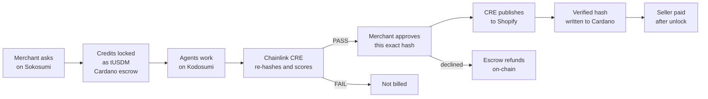

The result is a growth agency that a merchant can audit transaction by transaction:

- **27.1 → 72.9/100.** The listing score of a brand-new Travel Tumbler listing after the 12 specialists worked on it
  ([before](runs/tumbler/01-quinn-before/README.md) → [after](runs/tumbler/13-quinn-after/README.md)).
- **12/12 Chainlink PASS** on a full-team run: [14 store changes published, listing 75.2 → 82.0, about 13 minutes,
  16 tUSDM](runs/15-nora-bamboo-full-team/README.md).
- **45 Cardano transactions** that prove it, listed [above](#important-transactions).

---

## The problem

### 1. Merchants are drowning in work they can't afford

A product that sells needs:

- keyword research and competitor pricing
- review mining and copy that converts
- clean studio photos and a valid shopping feed
- an FAQ, translations and compliant claims
- a Google Ads account built on real break-even maths

That's a dozen skills. Agencies charge four figures a month for it, and freelancers charge per skill and need managing.
So most small merchants ship a one-line listing and pay for ads that send traffic to it. Each of those skills
compounds: copy without keywords doesn't rank, ads without negatives buy the wrong clicks, and photos without alt text
or the right channel sizes get rejected by Google Shopping.

### 2. AI agents are cheap, but unaccountable

Today's AI tools:

- **invent features** ("BPA-free!", "keeps ice for 48 hours!") that become legal liabilities
- **overwrite** copy that was working, with no record of what changed
- **use a competitor's trademark** in your ad copy, or bid above what a sale is worth
- **charge you either way**: the subscription renews whether the output was good or garbage

There is no receipt for *what* the AI did, no proof the output matches what was delivered, and no way to pay only
for work that held up.

### 3. The agent economy has no settlement layer that merchants trust

When software agents sell work to people, or hire each other, someone has to:

1. know *which* agent did the work (identity),
2. hold the money while the work happens (escrow),
3. tie the payment to a *specific* deliverable (commitment),
4. return the money when the work fails (refund),
5. let the buyer object before the money moves (dispute).

A database row in the vendor's own backend does none of that credibly. A public ledger does.

### 4. Ads are where the money burns

About 1.1M Shopify stores run the Google Ads tag. A badly built campaign (broad keywords, no negatives, a bid above
break-even, an ad that promises what the product can't do) loses money on every click. A small merchant gets one
shot at it.

---

## The solution

**Uplift is a verified, pay-for-proof AI growth team. It is sold on Sokosumi, settled on Cardano and refereed by
Chainlink.**

| Problem | How Uplift answers it |
|---|---|
| A dozen skills, no budget | **13 specialists** at **0.25–2.5 tUSDM** each (25–250 Sokosumi credits). A full team on one product costs **16 tUSDM**, quoted up front with a merchant-set ceiling. |
| AI hallucinates and overwrites | Every deliverable is scored by **Chainlink CRE**. Store changes can only be written by the CRE workflow, only verbatim from a verified deliverable, and only after the merchant approves that exact change-set hash. |
| No receipt | Every artifact is **content-addressed** (`artifacts/{sha256}/…`). That same hash is written into the **Cardano escrow** as the result. One hash ties together the files, the Chainlink verdict and the on-chain payment. |
| Paying for bad work | Payment is locked in **Masumi escrow on Cardano** before work starts and released only against a submitted result. Failed specialists are left out of Nora's bill. Declined Tasks never get a result, so the escrow refunds on-chain. |
| Ads burn money | **Sasha** builds paused Google Ads campaigns from break-even economics. **Ruth** filters the claims. Chainlink checks that every bid is below break-even. The [Google Ads mock](ads-mock/README.md) shows the run's real campaigns, keywords and ads before a cent is spent. |

### Three layers of trust

Uplift splits trust across three systems, so no single party, Uplift included, can cheat the merchant:

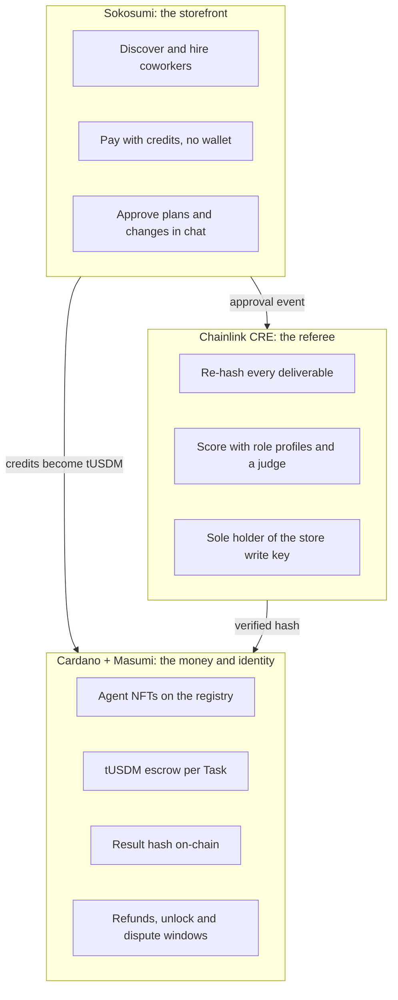

### What a merchant sees

1. **Hire.** On Sokosumi, pick Nora (the whole team) or one specialist, and describe the job in plain English. A
   connected Shopify store is optional for research-only roles. The store-writing roles ask the merchant to connect
   once through the gateway.
2. **Approve the plan.** Nora replies with the specialists, why each one is needed, the price ceiling and a plan hash.
   The merchant can push back in plain English. In [run 15](runs/15-nora-bamboo-full-team/README.md) the merchant
   wrote *"Skip the translation please, I only sell in English in the US"*, and Nora re-planned in 13 seconds.
3. **Watch it run.** The `/live` page streams every step: which agent, which service, which Chainlink check, and the
   Cardano escrow with its transactions.
4. **Approve the changes.** Nora shows the merged change set (title, copy, images, FAQ, translations, discount codes)
   and the projected score, together with its hash. Reply **approve**.
5. **Get the result.** Chainlink publishes to Shopify. Nora delivers the before/after score, a launch pack zip and a
   link to preview the Google Ads campaigns. The result hash lands on Cardano.

### Hire one specialist, or the whole team

|  | Standalone specialist | Nora (full team) |
|---|---|---|
| Pricing on Masumi | **Fixed**, the specialist's own price | **Dynamic**: the sum of the specialists who passed, capped by the quote |
| When the escrow locks | At the start; work runs while the lock confirms | After the work, for exactly what passed |
| Approvals | One, for that specialist's change set | Two: the plan (with a price ceiling), then the merged change set |
| Chainlink | One verify (+ one retry), one publish | One verify per specialist, run in parallel, plus one publish for the whole set |
| Code | [`specialist.py`](services/worker/src/uplift_worker/specialist.py) | [`nora.py`](services/worker/src/uplift_worker/nora.py) |

---

## System architecture

<div align="center">

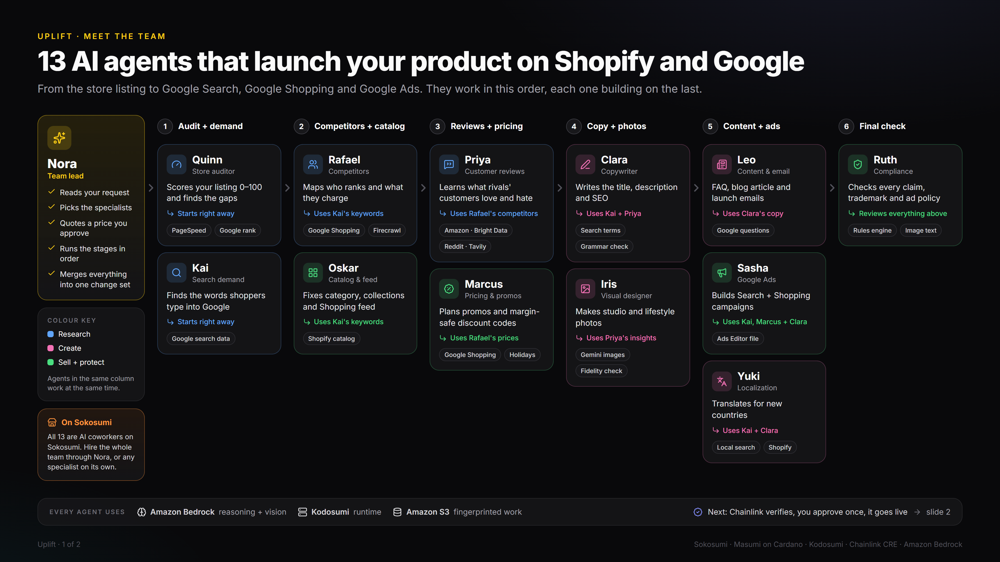

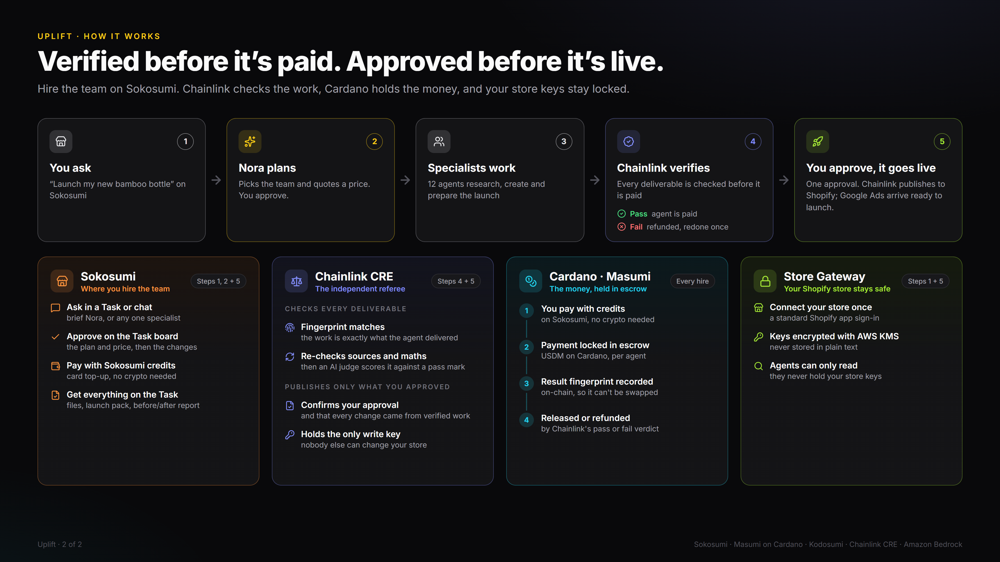

</div>

### 4.1 The big picture

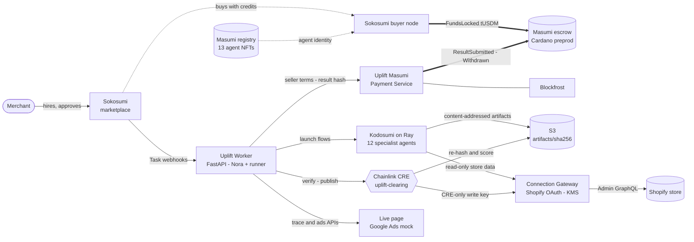

### 4.2 Components

| Component | What it does | Code |
|---|---|---|
| **Worker** (FastAPI) | Receives Sokosumi Task webhooks and runs **Nora's** state machine and the **standalone specialist** runner. Talks to the Masumi payment node and triggers Chainlink CRE. Serves the `/trace` and `/ads` APIs. Run state is journaled in Postgres, so every step survives a restart. | [`services/worker/`](services/worker/src/uplift_worker/app.py) |
| **Agents** (Kodosumi on Ray) | 12 specialist flows, one module each. Each one is a MIP-003 endpoint that Masumi can call. | [`agents/src/uplift_agents/app.py`](agents/src/uplift_agents/app.py#L22-L59), [`flows/`](agents/src/uplift_agents/flows) |
| **Masumi Payment Service** | Uplift's own Cardano payment node, pinned and patched: seller terms, escrow tracking, result submission, auto-withdraw. | [`infra/mps/deploy.sh`](infra/mps/deploy.sh) |
| **Chainlink CRE workflow** `uplift-clearing` | Two actions. **verify** hash-checks and scores a deliverable. **publish** checks approval, provenance and ownership, then writes to Shopify. | [`cre/uplift-clearing/main.ts`](cre/uplift-clearing/main.ts) |
| **Connection Gateway** | Shopify OAuth. Tokens are envelope-encrypted with AWS KMS + AES-GCM. A read API for agents and a **write API whose key only the CRE workflow holds**. | [`services/gateway/`](services/gateway/src/uplift_gateway/app.py) |
| **Core library** | RFC 8785 canonical JSON and hashes, change-set ownership, Listing Score, rules engine, Bedrock client. Mirrored line-for-line in TypeScript for CRE. | [`packages/core/`](packages/core/src/uplift_core) ↔ [`cre/uplift-clearing/src/core.ts`](cre/uplift-clearing/src/core.ts) |
| **Rules** | 13 compliance rules (superlatives, environmental, health, cosmetics, guarantees, pricing, platform, trademarks), shared by Ruth, Quinn and CRE. | [`rules/uplift-rules.json`](rules/uplift-rules.json) |
| **Landing + `/live`** | The marketing site, plus a live trace of any Task: agent steps, services, Chainlink verdicts and the Cardano escrow card. | [`landing/app/live/`](landing/app/live/page.tsx) |
| **Google Ads mock** | A standalone Google Search + Google Ads replica. It loads a finished run's verified campaigns, keywords, ads and offers. | [`ads-mock/`](ads-mock/README.md), [`ads_api.py`](services/worker/src/uplift_worker/ads_api.py) |
| **Registration** | Sokosumi coworker listings and Masumi registry NFTs. | [`infra/sokosumi/`](infra/sokosumi/register.py), [`infra/masumi/`](infra/masumi/register.py) |

### 4.3 Deployment

Everything runs on Railway, except Sokosumi (hosted by Masumi), Cardano preprod (reached through Blockfrost) and the
external data services the agents call.

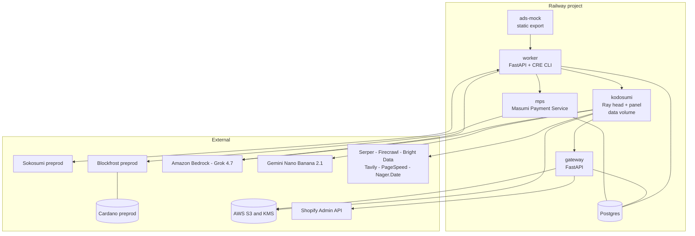

The Kodosumi image boots the `uplift` app and points Kodosumi's Masumi integration at Uplift's own payment node
([`boot.py`](infra/kodosumi/boot.py)). The MPS image is built from a pinned upstream commit
([`deploy.sh`](infra/mps/deploy.sh)). The Worker image bundles the Chainlink CRE CLI
([`Dockerfile`](services/worker/Dockerfile)).

### 4.4 The life of one Task

Here is a single Clara Task ([run 16](runs/16-clara-bamboo-traced/README.md)), traced hop by hop. Every hop below
appears in that run's [`trace.json`](runs/16-clara-bamboo-traced/trace.json).

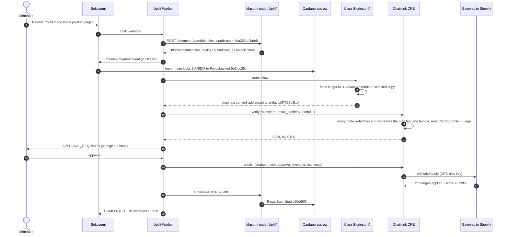

The code for each hop:

| Hop | Where |
|---|---|
| Webhook dispatch to Nora or to the specialist runner | [`app.py#L32-L34`](services/worker/src/uplift_worker/app.py#L32-L34) |
| Specialist state machine | [`specialist.py#L65-L290`](services/worker/src/uplift_worker/specialist.py#L65-L290) |
| Seller terms, with the input hash committed | [`payments.py#L24-L48`](services/worker/src/uplift_worker/payments.py#L24-L48) |
| Charge through Sokosumi → escrow lock | [`payments.py#L58-L100`](services/worker/src/uplift_worker/payments.py#L58-L100) |
| Launch on Kodosumi | [`clients.py#L116-L127`](services/worker/src/uplift_worker/clients.py#L116-L127) |
| Manifest + verification bundle, content-addressed | [`runtime.py#L97-L153`](agents/src/uplift_agents/runtime.py#L97-L153) |
| `result_hash = sha256(JCS(manifest))` | [`specialist.py#L203`](services/worker/src/uplift_worker/specialist.py#L203), [`hashing.py#L13-L26`](packages/core/src/uplift_core/hashing.py#L13-L26) |
| CRE verify | [`specialist.py#L208-L225`](services/worker/src/uplift_worker/specialist.py#L208-L225) → [`main.ts#L25-L66`](cre/uplift-clearing/main.ts#L25-L66) |
| Wait for a *confirmed* FundsLocked | [`payments.py#L103-L135`](services/worker/src/uplift_worker/payments.py#L103-L135) |
| Approval → CRE publish | [`specialist.py#L227-L268`](services/worker/src/uplift_worker/specialist.py#L227-L268) → [`main.ts#L91-L125`](cre/uplift-clearing/main.ts#L91-L125) |
| Submit the result hash on-chain | [`specialist.py#L270-L276`](services/worker/src/uplift_worker/specialist.py#L270-L276) → [`payments.py#L138-L144`](services/worker/src/uplift_worker/payments.py#L138-L144) |

### 4.5 The specialist state machine

Every phase is **journaled to Postgres before its side effect**. A crash, redeploy or network failure resumes from the
last journaled phase. It never charges twice, never opens a second escrow, never publishes twice: the payment terms
are reused until their deadline, and the gateway is idempotent by change hash.

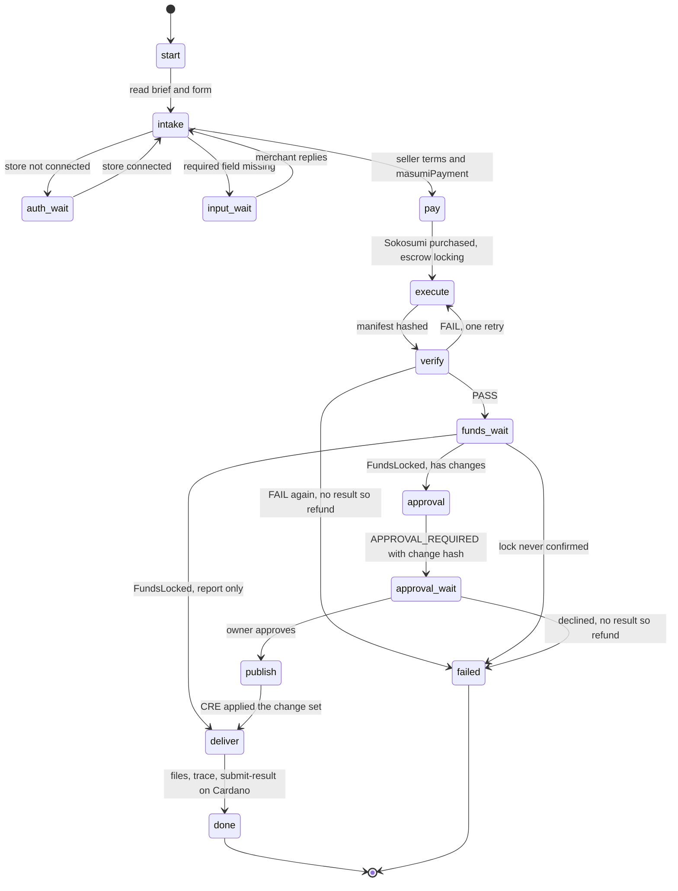

### 4.6 One hash to rule them all

The design rests on one idea: **a deliverable is named by its hash, and that name travels everywhere.**

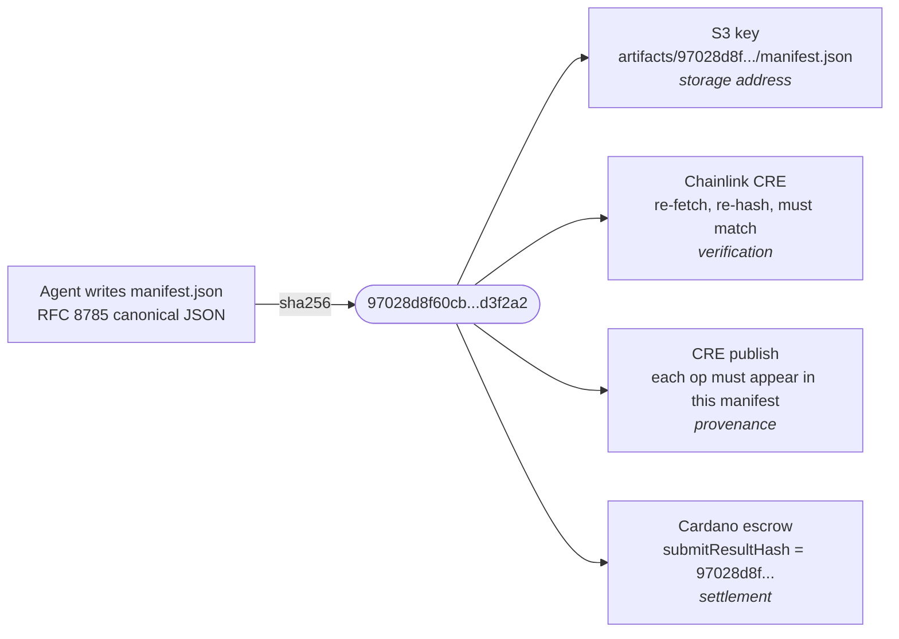

A tampered artifact would change the hash. Chainlink would then refuse it, the publish would fail its provenance
check, and the on-chain result would no longer match the files.

A manifest lists every artifact with its own sha256 and MIME type, plus the change set the role proposes and a
pointer `{url, sha256}` to a separate **verification bundle**. The bundle carries the evidence a verifier needs: the
facts ledger, the raw search results, the review sample, the fidelity scores and so on
([`finalize`](agents/src/uplift_agents/runtime.py#L133-L153)). The manifest's hash therefore covers every file the
merchant receives and all the evidence behind it.

Python and TypeScript produce byte-identical hashes; [`e2e/cre_parity.py`](e2e/cre_parity.py) proves it on every
change.

### 4.7 Trust boundaries

- **Agents cannot write to the store.** They get a read token for the gateway's read API
  ([`tools.py#L61`](agents/src/uplift_agents/tools.py#L61)). The write API
  ([`gateway app.py#L217-L241`](services/gateway/src/uplift_gateway/app.py#L217-L241)) accepts only the CRE workflow's
  key. It re-hashes the change set, refuses a mismatch, and records every applied change hash so a replay returns the
  first result instead of writing twice.
- **Store tokens are never stored in plaintext.** Each one is sealed with a KMS data key and AES-GCM, with the
  user/org/platform as associated data ([`crypto.py#L19-L29`](services/gateway/src/uplift_gateway/crypto.py#L19-L29)).
  Shopify's expiring offline tokens are refreshed and the refresh token rotated
  ([migration](services/gateway/migrations/002_expiring_tokens.sql)).
- **OAuth is verified twice.** Shopify's callback HMAC is checked, and the signed `state` binds the connection to the
  Sokosumi user and org that started it. Nonces are single-use (`used_nonces`). `app/uninstalled` and `shop/redact`
  webhooks revoke the link.
- **Upstream reads are verified.** When Clara reads Kai's keywords, the runtime re-checks the sha256 of what it
  downloads ([`runtime.py#L69-L78`](agents/src/uplift_agents/runtime.py#L69-L78)).
- **Each field has an owner.** Clara owns the title and copy, Iris the media, Yuki translations and so on
  ([`core.ts#L33-L56`](cre/uplift-clearing/src/core.ts#L33-L56), [`changeset.py#L44`](packages/core/src/uplift_core/changeset.py#L44)).
  CRE refuses any op that comes from the wrong role.
- **Nothing is published before the escrow locks**, and nothing is delivered either
  ([`nora.py#L285-L293`](services/worker/src/uplift_worker/nora.py#L285-L293)).

### 4.8 Connecting a store

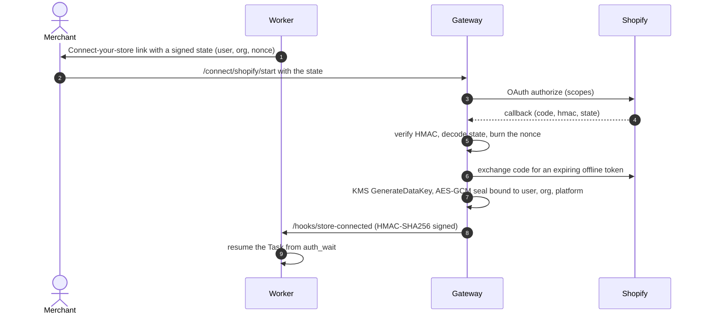

Code: [`connect_start` / `connect_callback`](services/gateway/src/uplift_gateway/app.py#L69-L130),
[`crypto.py`](services/gateway/src/uplift_gateway/crypto.py), Worker hook
[`/hooks/store-connected`](services/worker/src/uplift_worker/app.py#L140-L150).

### 4.9 Data stores

| Store | Table / prefix | Holds |
|---|---|---|
| Worker Postgres | `runs` | One row per (Task, coworker): `phase`, a JSON `state` journal (payment terms, node results, verdicts, approvals) and `updated_at` |
|  | `cre_results` | Chainlink callbacks, matched by `request_id` |
|  | `trace_events` | Every step the `/live` page shows: service, kind, timing, metadata such as tx and result hashes |
|  | `rank_checks` | Store-search ranks before and after |
|  | `conversations`, `responses` | The coworker chat API (Responses-API shape) |
| Gateway Postgres | `store_links` | Encrypted Shopify tokens, data keys and expiry |
|  | `used_nonces` | One-time OAuth state nonces |
|  | `applied_changesets` | `change_hash` → result: the idempotency ledger of every store write |
| S3 | `artifacts/{sha256}/{name}` | Every deliverable, bundle and manifest, addressed by content |
| S3 | `artifacts/{change_hash}/changeset.json` | Every change set the merchant was asked to approve |
| Cardano | Masumi escrow datum | `inputHash`, `resultHash`, deadlines, buyer and seller |

### 4.10 Stack

| Concern | Choice |
|---|---|
| Services and agents | Python 3.12, `uv` workspace, FastAPI, Kodosumi on Ray 2.48 |
| Verification | Chainlink CRE (`@chainlink/cre-sdk`, TypeScript → WASM, Bun) |
| Settlement | Masumi Payment Service (`Web3CardanoV2`) on Cardano preprod via Blockfrost; tUSDM |
| Marketplace | Sokosumi (preprod): 13 coworkers |
| LLM | Grok 4.7 on Amazon Bedrock for text and vision; Gemini Nano Banana 2.1 for product imagery |
| Web data | Serper (Google search, Shopping, autocomplete), Firecrawl (2-key failover), Bright Data, Tavily, PageSpeed, Nager.Date |
| Hashing | RFC 8785 JCS: `rfc8785` (Python), `canonicalize` (TS) |
| Store | Shopify Admin GraphQL `2026-10` |
| Hosting | Railway: Postgres, gateway, worker, Kodosumi, MPS, ads mock |

### 4.11 Run it yourself

```sh
uv sync --all-packages && (cd cre/uplift-clearing && bun install)

uv run python e2e/cre_parity.py                       # Python ↔ CRE hash, rule and score parity
uv run --with httpx python e2e/payments.py --limit 50 # Uplift's Cardano escrows, with explorer links

sh infra/mps/deploy.sh                                # Masumi payment node (selling wallet needs test ADA)
uv run python infra/masumi/register.py --publish      # mint the 13 registry NFTs on Cardano preprod
uv run python infra/sokosumi/register.py --worker-url https://<worker> --push   # list the coworkers

cd cre && cre workflow simulate uplift-clearing --non-interactive --trigger-index 0 \
  --http-payload '<json>' --target local-simulation   # the Chainlink workflow
```

Other end-to-end checks live in [`e2e/`](e2e):

- [`gateway_e2e.py`](e2e/gateway_e2e.py): connect, read, write, idempotency and revert against a real store.
- [`flows_e2e.py`](e2e/flows_e2e.py) and [`task_e2e.py`](e2e/task_e2e.py): agent flows and full Sokosumi Tasks.
- [`record_run.py`](e2e/record_run.py): records a finished Task into `runs/`.
- [`trace.py`](e2e/trace.py): a terminal viewer for the live trace.
- [`rank.py`](e2e/rank.py): store-search rank checks.

Secrets never live in the repo. Services read Railway variables, the CRE simulator reads `cre/.env` (a deployed
workflow reads the Vault DON), and coworker keys are captured once into `infra/.secrets/` (0600).

---

## The agents

Thirteen agents: one lead, twelve specialists. Each specialist is four things at once:

- a **Kodosumi flow**
- a **MIP-003 agent API**
- a **Masumi registry NFT on Cardano**
- a **Sokosumi coworker**

Prices are in tUSDM, the test USD stablecoin the Masumi escrow holds on Cardano. Merchants pay with Sokosumi
workspace credits, which Sokosumi charges at 100 credits per tUSDM. Every specialist is verified by its own **Chainlink
profile**: a set of checks worth points, some of them gates, plus up to 5 points from an LLM judge. The pass mark is
40 points with every gate passed ([`profiles.ts`](cre/uplift-clearing/src/profiles.ts)).

### How the team fits together

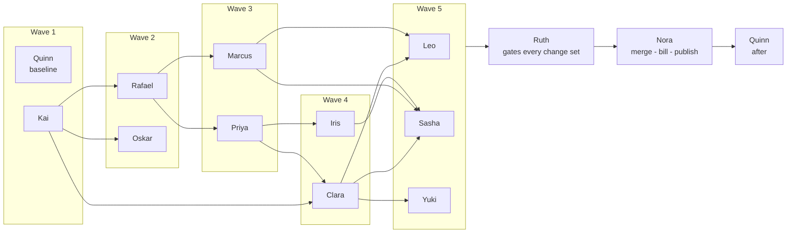

The main arrows come from [`DEPENDS`](services/worker/src/uplift_worker/nora.py#L42-L44). (Leo, Sasha and Yuki also read Kai, and Leo reads Rafael and Priya.) An agent
starts only when everything it reads **has passed Chainlink**, and it re-checks the hash of every upstream file it downloads.

### What each agent hands to the next

| Artifact | Produced by | Consumed by |
|---|---|---|
| `keyword_map.json` | Kai | Rafael, Clara, Oskar, Leo, Sasha, Yuki, Quinn |
| `competitor_set.json` | Rafael | Priya, Sasha (brand negatives), Ruth (trademarks) |
| `price_bands.json` | Rafael | Marcus |
| `competitor_matrix.json` | Rafael | Leo (comparison table) |
| `findings.json` | Priya | Clara (objections), Leo |
| `win_plan.json` | Priya | Iris (missing shot types), Sasha (ad angles) |
| `promo_calendar.json` | Marcus | Leo (emails) |
| `facts.json` | Clara | Leo, Sasha (no ad may claim what's not a fact) |
| Clara's change set | Clara | Yuki (translates the *new* copy) |
| `google_shopping.jpg` | Iris | Google Ads mock (Shopping ad image) |

### Nora: Uplift Lead

> *Dynamic pricing: the sum of the specialists who passed · lives in the Worker · [`nora.py`](services/worker/src/uplift_worker/nora.py)*

Nora is the conductor. She never does the work herself: she plans it, prices it, runs it, makes sure Chainlink signed
off on every piece and bills for exactly what passed.

**1. Plan.**

- Grok reads the brief and maps it onto [`CAPABILITIES`](services/worker/src/uplift_worker/nora.py#L36-L40)
  (keywords → Kai, ads → Sasha and so on), keeping only capabilities with a fit of at least 0.4.
- A dependency closure ([`close()`](services/worker/src/uplift_worker/nora.py#L48-L61)) adds what the plan needs:
  - copy, content, ads or translation add Kai, unless the merchant supplied keywords
  - copy, content, images or ads add Priya
  - Priya and Marcus add Rafael, unless the competitors are known
  - ads add Marcus and Iris
- Ruth and Quinn are always on the team ([`plan()`](services/worker/src/uplift_worker/nora.py#L64-L97)).
- Yuki is dropped if no locale is requested, or if the only locale is the store's own language.

**2. Quote, under a ceiling.**

- [`quote()`](services/worker/src/uplift_worker/nora.py#L100-L107) prices each role. Yuki is priced per locale; Quinn
  counts twice (baseline and after).
- If the merchant stated a budget, optional roles are dropped in reverse order until the quote fits
  ([L195-L199](services/worker/src/uplift_worker/nora.py#L195-L199)). Quinn, Clara and Ruth are never dropped.
- The plan is hashed and embedded in the approval request
  ([L201-L212](services/worker/src/uplift_worker/nora.py#L201-L212)). Chainlink later **rejects any specialist work
  outside the approved plan** ([`main.ts#L17-L23`](cre/uplift-clearing/main.ts#L17-L23)), so Nora can't upsell
  herself after the fact.

**3. Run the team as a DAG** ([`step_dag`](services/worker/src/uplift_worker/nora.py#L433-L470)).

- [`hire()`](services/worker/src/uplift_worker/nora.py#L349-L361) launches a specialist's Kodosumi flow with an
  envelope:
  - a store read token
  - a store snapshot
  - the hashes of every upstream result that passed
  - the failure reasons from a previous attempt, if any
- Every delivered result is verified **in parallel**, because Chainlink checks are independent and one slow check must
  not hold up the others.
- A failure is retried once with the reasons attached and is **never billed**
  ([`_verify`](services/worker/src/uplift_worker/nora.py#L402-L422)).

**4. Merge** ([`merge`](services/worker/src/uplift_worker/nora.py#L481-L510)).

- Nora collects every passed change set and hands the merged set to Ruth.
- Unresolved high-severity hits remove the offending ops.
- Translations made from copy that won't go live are dropped.
- Nora projects the new Listing Score.

**5. Bill once, on Cardano.**

- [`bill()`](services/worker/src/uplift_worker/nora.py#L513-L521) sums the specialists who passed, plus Quinn's
  after-report.
- One Masumi escrow is requested for exactly that amount, with **Dynamic** pricing
  ([L246-L256](services/worker/src/uplift_worker/nora.py#L246-L256)).
- In [run 00](runs/00-nora-glass-bottle/README.md), Leo failed Chainlink twice, so the merchant was billed **7.25**
  tUSDM and Leo's 2.0 was not charged.

**6. Approve, publish and report.**

- One approval covers the whole change set ([`propose`](services/worker/src/uplift_worker/nora.py#L532-L546)).
  Ads stay paused and the blog article stays unpublished.
- Publishing waits for the escrow lock. Chainlink then publishes, and Quinn re-scores the live listing.
- Nora writes a hash of the CRE publish result into the Cardano escrow
  ([L322-L333](services/worker/src/uplift_worker/nora.py#L322-L333)).
- [`deliver`](services/worker/src/uplift_worker/nora.py#L579-L595) zips everything into `uplift-launch-pack.zip`. When
  Sasha passed, it adds a link to the [Google Ads mock](ads-mock/README.md) preview of the run's real campaigns.

Her MIP-003 face for the Masumi registry is [`agent_api.py`](services/worker/src/uplift_worker/agent_api.py#L10-L32).

**A full-team run, minute by minute** ([run 15](runs/15-nora-bamboo-full-team/README.md); the axis is minutes:seconds
after the Task was created). Each bar starts when that specialist's inputs had passed Chainlink and ends when its own
verdict came back:

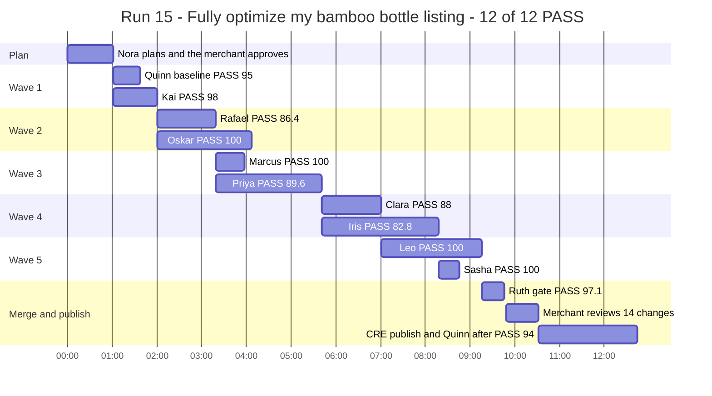

---

### Quinn: Store Auditor & Performance Analyst · 0.5 tUSDM

> [`flows/quinn.py`](agents/src/uplift_agents/flows/quinn.py) · report only · runs first and last

**Mission.** Tell the merchant how good the listing is, prove it with numbers, and route every gap to the teammate who
can fix it.

**How it works.**

1. Computes the **Listing Score**: 95 deterministic points across title, description, media, SEO, structure and
   compliance ([`score.py`](packages/core/src/uplift_core/score.py#L32-L111)), plus up to 5 from a Grok persuasion
   judge.
2. Checks **where the product ranks**: Google's top 20 through Serper, and the store's own search through the gateway.
   It also runs **PageSpeed** on the live page, and in diagnose mode pulls sales through **ShopifyQL**.
3. Writes a **fix plan** that maps each gap to a specialist and that specialist's real price, so the merchant can hire
   the fix in one click.
4. In `before_after` mode, re-audits the live listing against its own baseline.

**Delivers** `audit_report.json`, `audit_report.md`, `fix_plan.json`.

**Chainlink checks:**

- **Score agreement** (50): CRE recomputes the deterministic score in TypeScript, and it must match within 3 points.
- **Analytics numbers** (20)
- **Fix-plan mapping** (5): every fix goes to a real specialist with a price.
- **Findings reproduced** (20): CRE re-runs the Google search itself and Quinn's claimed position must be within 5.

**In the test.** The new Travel Tumbler scored **27.1/100**. Quinn routed trust to Leo, the catalog to Oskar, copy to
Clara, keywords to Kai and images to Iris. After they ran, he scored it **72.9/100**.

### Kai: Search Demand Analyst · 1.25 tUSDM

> [`flows/kai.py`](agents/src/uplift_agents/flows/kai.py) · report only · the team's foundation

**Mission.** Find what real shoppers type into Google, not what the merchant guesses.

**How it works.**

1. Grok proposes seed terms from the product facts.
2. **Serper** expands each seed through Google autocomplete, related searches and People Also Ask.
3. Each keyword gets a **demand score** (0–100) from those signals
   ([`kai.py#L43-L51`](agents/src/uplift_agents/flows/kai.py#L43-L51)). CRE uses the same formula.
4. Grok detects **brand terms**, which move to negatives so the merchant never bids on a competitor's name.
5. Keywords are clustered by **intent** and each cluster is assigned a destination: title, description, SEO meta,
   blog, ads phrase or ads exact.

**Delivers** `keyword_map.json`, `keyword_map.csv`, `negatives.txt`.

**Chainlink checks:**

- **No foreign trademarks** (20)
- **Demand recomputed** (20): ≥ 95% of the scores must match CRE's own recomputation.
- **Cluster integrity** (15)
- **Intent labels** (10)
- **Keywords are real** (30): CRE samples keywords and confirms them against live Google autocomplete.

**In the test.** **222 keywords** in 6 clusters, primary *"400ml coffee tumbler"* (demand 54.2), and **121 brand or
irrelevant terms** moved to negatives. Chainlink: **PASS 100**.

### Rafael: Competitor & Market Analyst · 1.25 tUSDM

> [`flows/rafael.py`](agents/src/uplift_agents/flows/rafael.py) · report only

**Mission.** Find who the merchant actually competes with, what they charge and where the gaps are.

**How it works.**

1. Reads Kai's keyword map and searches **Google** and **Google Shopping** (Serper) with the strongest commercial
   queries.
2. Grok filters out marketplaces, articles and unrelated products. What's left is the real competitor set.
3. **Firecrawl** scrapes each competitor page into a structured schema: product, price, claims and features.
4. Computes **price bands**, then Grok writes positioning and "where to win" gaps.

**Delivers** `competitor_matrix.json/.csv`, `price_bands.json`, `positioning.md`, `gaps.md`, `competitor_set.json`.

**Chainlink checks:**

- **Band maths** (20)
- **Coverage** (15)
- **Evidence URLs** (5)
- **Cited pages support the facts** (35): CRE re-fetches the cited pages on every node.
- **Ranking sanity** (20)

**In the test.** 3 competitors across 5 queries and price bands **$9.27–$40.00** (median $11.98). One of the gaps
found: *"own 'best leak-proof 400ml under $30' with tested spill and heat-retention data"*. Chainlink: **PASS 86.4**.

### Priya: Competitor Review & Sentiment Analyst · 1.5 tUSDM

> [`flows/priya.py`](agents/src/uplift_agents/flows/priya.py) · report only · never analyses the merchant's own reviews

**Mission.** Learn from the competitors' unhappy customers, so the merchant's page answers their complaints first.

**How it works.**

1. Collects reviews of Rafael's competitor set from **Amazon** (Bright Data), storefronts and **Trustpilot**
   (Firecrawl), and **Reddit** threads (Tavily). A Reddit quote is kept only if it appears **verbatim** on the page
   ([`tools.py#L216-L247`](agents/src/uplift_agents/tools.py#L216-L247)).
2. Grok codes every review by **aspect** (lid, leaks, cleaning, insulation, durability…) and sentiment.
3. Builds **personas** grounded in review IDs and a **win plan**: what to say, show and photograph.

**Delivers** `competitor_sentiment_report.md`, `findings.json`, `coded_reviews.json`, `personas.json`, `win_plan.json`.

**Chainlink checks:**

- **Competitor-only** (15)
- **Counts recomputed** (25)
- **Persona evidence** (10)
- **Coverage** (10)
- **Win-plan grounding** (5)
- **Quotes are verbatim** (30): CRE re-fetches the source pages and finds the quotes.

**In the test.** **530 competitor reviews** analysed. Top complaints to win on: cleaning, lid, durability, insulation,
leaks. Chainlink: **PASS 92**.

### Marcus: Pricing & Promotions Strategist · 1.25 tUSDM

> [`flows/marcus.py`](agents/src/uplift_agents/flows/marcus.py) ·  writes `discount.create`

**Mission.** Price and promote the launch without ever selling below the margin floor.

**How it works.**

1. Reads price and unit cost from the store snapshot, Rafael's price bands and the existing discount codes, so codes
   never collide.
2. Pulls public holidays (Nager.Date) for the market and builds a **promo calendar** (`.ics` included).
3. Grok proposes scenarios and codes. Any code whose discounted margin breaks the **35% floor is dropped**
   ([`marcus.py#L125`](agents/src/uplift_agents/flows/marcus.py#L125)).

**Delivers** `pricing_strategy.md`, `scenarios.csv`, `promo_calendar.json/.ics`, `discount_codes.json`.

**Chainlink checks:**

- **Margin safety** (35)
- **Dates** (20)
- **Code hygiene** (15)
- **Scenario maths** (15)
- **Band references** (10)

**In the test.** Positioned at parity ($26 vs a $28.99 median), with 3 scheduled codes, all above the floor:

| Code | Discount | Window |
|---|---|---|
| `TTSINGLE25` | 20% | 11/11 |
| `TTBF26` | 25% | Black Friday |
| `TTGIFT20` | 15% | Dec 15–24 |

The first attempt was declined by the merchant and **refunded on-chain**
([`3a555c02…`](https://preprod.cexplorer.io/tx/3a555c02c50ef458ebadec825e46880247ee984bf8041c41c8228475cb017f73)).
The retry passed with **PASS 99** and was published.

### Clara: Product Page Copywriter · 2.0 tUSDM

> [`flows/clara.py`](agents/src/uplift_agents/flows/clara.py) ·  writes title, description, SEO, tags

**Mission.** Write copy that ranks and sells, without inventing a single feature.

**How it works.**

1. Builds a **facts ledger** from the merchant's brief and the current listing. Every fact gets an ID.
2. Writes **3 variants in parallel**, each tagging its claims with fact IDs, and folds in Kai's keywords and Priya's
   objections.
3. Scores the variants on a **rubric**: format, keyword placement, grounding, objection coverage and readability.
   Grammar-checks the winner.
4. Proposes the change set: title, `descriptionHtml`, SEO title and meta, and tags. A live product's handle is never
   changed, so no links break.

**Delivers** `selected_copy.html`, `copy_variants.json`, `facts.json`, `rubric_scores.json`.

**Chainlink checks:**

- **Ownership** (gate): Clara may only touch fields she owns.
- **Format** (25)
- **Keyword placement** (15)
- **Fact grounding** (25): ≥ 85% of claims must cite a real fact.
- **Keyword coverage** (10)
- **Objection coverage** (10)
- **Readability and grammar** (10): a Flesch score between 30 and 80.

**In the test.** *"Travel Coffee Tumbler: 400ml Stainless Steel TT-400"*, with a rubric score of 37/45 and **100% of
claims grounded in 12 facts**. Chainlink: **PASS 91.4**.

### Iris: Product Visual Designer · 2.5 tUSDM

> [`flows/iris.py`](agents/src/uplift_agents/flows/iris.py) ·  writes media, alt text, order

**Mission.** Turn one phone photo into a full, channel-ready image set that still looks exactly like the real product.

**How it works.**

1. **Audits** the existing images with Grok vision against the shot types a listing needs (hero, angle, detail,
   scale, lifestyle), using Priya's win plan.
2. **Gemini Nano Banana 2.1** renders a clean white-background hero and lifestyle scenes
   ([`tools.py#L328-L340`](agents/src/uplift_agents/tools.py#L328-L340)).
3. A **fidelity check** compares every render with the merchant's original photo (Grok vision + perceptual hash).
   **A render below 0.90 is thrown away**, so no AI-invented product reaches the store.
4. Exports channel sizes (store, Google Shopping, Google Ads square and landscape, Amazon, social), writes alt text
   and sets the image order.

**Delivers** `clean_hero.jpg`, `scene_N.jpg`, channel exports, `visual_audit.json`, `alt_text.json`, `order.json`,
`fidelity.json`.

**Chainlink checks:**

- **Product fidelity** (25): every scene ≥ 0.90.
- **Channel rules** (25): for example, no overlays on the Google Shopping image.
- **Alt text** (15)
- **Hero** (15): at least 1000 px wide.
- **Gap closure** (10)
- **Ownership** (5)

**In the test.** The tumbler was missing hero, angle, detail and scale shots. Iris added a white hero and 2 lifestyle
scenes, all at fidelity ≥ 0.90, with alt text for every image. Chainlink: **PASS 95**.

### Oskar: Catalog, Collections & Shopping Feed · 1.5 tUSDM

> [`flows/oskar.py`](agents/src/uplift_agents/flows/oskar.py) ·  writes category, type, tags, collections,
> related products · needs a connected store

**Mission.** Make the product findable in the store's navigation and acceptable to Google Merchant Center.

**How it works.**

1. Maps the product to the **Shopify Standard Product Taxonomy** (category candidates come from the gateway; Grok
   picks).
2. Cleans the type and tags, adds the product to existing collections or proposes a new one, and links related and
   complementary products through metafields.
3. Validates **GTINs** with a real checksum and builds a **Google supplemental feed** that lists the missing fields.

**Delivers** `catalog_changes.json`, `collections_plan.md`, `feed_report.json`, `google_supplemental.csv`,
`barcode_fixes.csv`.

**Chainlink checks:**

- **Ownership** (gate)
- **Category validity** (30): the category must be one of the gateway's candidates.
- **Collections** (20)
- **Related links** (15): only real product GIDs.
- **Tag hygiene** (15)
- **Export schema** (15)

**In the test.** Category *Home & Garden › Kitchen & Dining › Food & Beverage Carriers › Travel Mugs*. The feed report
flagged the missing `gtin_or_mpn`. Chainlink: **PASS 100**.

### Leo: Content & Email Marketer · 2.0 tUSDM

> [`flows/leo.py`](agents/src/uplift_agents/flows/leo.py) ·  writes FAQ and comparison metafields and a **draft** article

**Mission.** Answer every question a shopper asks before buying, and keep the conversation going after they leave.

**How it works.**

1. Builds an **FAQ** from real People Also Ask questions, each answer grounded in Clara's facts.
2. Builds a **comparison table** against Rafael's competitors, citing each competitor's page.
3. Writes a **blog article** sized to what already ranks, with store-only links. It is created **unpublished**.
4. Writes an **email flow** with blueprints, SMS copy and a social pack, following Marcus's promo calendar. Every link
   carries a consistent `utm_campaign`.

**Delivers** `faq.json`, `comparison.json`, `blog_article.html`, `emails/`, `flow_blueprints.md`, `sms.txt`,
`social_pack.csv`.

**Chainlink checks:**

- **FAQ grounding** (20)
- **Search-query coverage** (10)
- **Comparison sourcing** (15)
- **Article** (20): length, store-only links, unpublished.
- **Email** (15): subject ≤ 70 characters, unsubscribe link, text version.
- **UTM consistency** (10)
- **Ownership** (5)

**In the test.** FAQ, emails and a social pack, every link tagged `utm_campaign=uplift-01a1147d-e02`. Chainlink:
**PASS 100**. One real bug was caught here: in a Nora run, Chainlink crashed on Leo's comparison table, Leo was **not
billed**, and the profile was fixed ([ISSUES §3](runs/ISSUES.md)).

### Sasha: Paid Ads Strategist · 1.5 tUSDM

> [`flows/sasha.py`](agents/src/uplift_agents/flows/sasha.py) · builds the Google Ads account · every campaign ships **Paused**

**Mission.** Build Google Ads campaigns that can't lose money per sale.

Sasha produces a complete Google Ads account: campaigns, ad groups, keywords, negatives, bids, budgets and responsive
ads, as a Google Ads Editor file that imports as-is. Pushing it live needs the merchant's own Google Ads account, so
in this build the campaigns are delivered paused and previewed in the
[Google Ads mock](https://ads-mock-production.up.railway.app), which loads the run's real, verified output.

**How it works.**

1. **Economics first.** Break-even cost per sale = price × margin. Max CPC = break-even × conversion rate. The budget
   respects the merchant's monthly cap ([`sasha.py#L43-L65`](agents/src/uplift_agents/flows/sasha.py#L43-L65)).
2. Builds a **Search** campaign (ad groups from Kai's clusters, phrase and exact match) and a **Shopping /
   Performance Max** campaign.
3. **Negatives** come from Kai's brand and irrelevant terms plus competitor brands from Rafael.
4. **Responsive search ads**: up to 15 headlines (≤ 30 characters) and descriptions (≤ 90), written only from Clara's
   facts and Priya's win plan.
5. Exports a **Google Ads Editor CSV** the merchant can import as-is.

**Delivers** `google_ads_editor.csv`, `unit_economics.json`, `ad_copy.json`, `ads_plan.md`, `tracking_checklist.md`.

**Chainlink checks:**

- **Spend cap** (25)
- **Bid safety** (25): every bid must be ≤ CRE's own break-even max CPC.
- **Negatives sanity** (15): negatives can't block the keywords.
- **Limits** (10)
- **Final URLs** (10): HTTPS, the merchant's store, UTM-tagged.
- **Paused state** (10)

**In the test.** Break-even CPA **$15.08**, max CPC **$0.21**, a $250/month budget and 15 headlines. Chainlink:
**PASS 99**.

**See it live.** When Sasha passes, the [Google Ads mock](https://ads-mock-production.up.railway.app) loads the run's
campaigns, ad groups, keywords, negatives, ads and Iris's Shopping image
([`ads_api.py`](services/worker/src/uplift_worker/ads_api.py)), with simulated traffic capped at break-even.

### Yuki: Localization & Transcreation · 1.0 tUSDM per locale

> [`flows/yuki.py`](agents/src/uplift_agents/flows/yuki.py) ·  writes `translations.register`

**Mission.** Sell in another language as well as in English, not just translate the words.

**How it works.**

1. Translates **Clara's verified new copy**, read through the hash-checked upstream, not the old copy in the store.
   It also fetches the store's translatable resource digests, so translations attach to the right version.
2. **Transcreates** idioms and units, and keeps locked terms (brand, model numbers) untouched.
3. **Back-translates** to catch meaning drift, and finds **local keywords** through local Google autocomplete.

**Delivers** `translations_{locale}.json`, `local_keywords_{locale}.csv`, `qa_report.md`.

**Chainlink checks:**

- **Digest freshness** (20)
- **Locked terms** (20)
- **Lengths** (15)
- **Local keyword** (15)
- **Completeness** (15)
- **Local keywords are real** (10)

**In the test.** German: *"Reisebecher aus Edelstahl TT-400 400 ml"*, local primary keyword *reisebecher aus
edelstahl*, no drift flags. Chainlink: **PASS 99**.

### Ruth: Claims & Compliance Reviewer · 0.25 tUSDM

> [`flows/ruth.py`](agents/src/uplift_agents/flows/ruth.py) · report only · **a gate on Nora's merge**

**Mission.** Make sure nothing Uplift publishes gets the merchant sued, delisted or fined.

**How it works.**

1. Scans every text segment, and every image through **Grok vision OCR**, against
   [`uplift-rules.json`](rules/uplift-rules.json) (13 rules: superlatives, environmental, health, cosmetics,
   guarantees, pricing, platform) and competitor **trademarks** from Rafael.
2. Asks Grok whether each hit is **substantiated** by the facts. If not, proposes a compliant rewrite.
3. In Nora's flow, unresolved **high-severity** hits remove the ops they touch before the merchant is asked to approve
   ([`nora.py#L481-L510`](services/worker/src/uplift_worker/nora.py#L481-L510)).

**Delivers** `compliance_report.md`, `compliance_report.json`.

**Chainlink checks:**

- **High-severity coverage** (40): CRE runs the same rules engine and Ruth can't miss a high hit.
- **Overall agreement** (30)
- **Rewrites** (25): the rewrites must themselves be clean.

**In the test.** The tumbler page passed with 0 findings. Chainlink: **PASS 95**.

### Proof of work: completed Tasks

Every row is a real Sokosumi Task, paid in credits through Masumi escrow and checked by Chainlink. Each run folder
holds the exact brief, every event with timestamps, the Sokosumi payment receipt, the verdicts and the full
deliverables.

| Recorded run (brief → deliverables) | Coworker | tUSDM | Chainlink | Escrow locked | Settlement on-chain | Sokosumi Task |
|---|---|---|---|---|---|---|
| [Polish my glass bottle page](runs/00-nora-glass-bottle/README.md) | Nora | 7.25 | 7/9 PASS | [`2288fd5a17…`](https://preprod.cexplorer.io/tx/2288fd5a171646d5fe8745c487a46df93b70d90c4b7c283fcbee4ff6d786c39b) |  ResultSubmitted [`f04f5d41f5…`](https://preprod.cexplorer.io/tx/f04f5d41f5086b6b2ba345b0f5bf80b1f49ed0c96f75e28340c067e2b83dfba3) | _(add link)_ |
| [Content and compliance for my glass bottle](runs/14-nora-full-team/README.md) | Nora | 16.0 | 12/12 PASS | [`b89e0053da…`](https://preprod.cexplorer.io/tx/b89e0053dacbaeec940ed6cb52a3fa4bbd74dc1c0c5e0fcbb6b8dc7b75288708) |  ResultSubmitted [`212748facb…`](https://preprod.cexplorer.io/tx/212748facbe64dad0fea84ae8c97867fd9eab74e57f4d1122c60b2aa5c3c6906) | _(add link)_ |
| [Fully optimize my bamboo bottle listing](runs/15-nora-bamboo-full-team/README.md) | Nora | 16.0 | 12/12 PASS | [`2aacdd0c1e…`](https://preprod.cexplorer.io/tx/2aacdd0c1e209c021f77bfba31876407b599418b18a28ceae784c3e109730ad1) |  ResultSubmitted [`d1bb34489f…`](https://preprod.cexplorer.io/tx/d1bb34489f28c2be807437eea5f08c63c08bf012773539460a7485c8fffd7f1c) | _(add link)_ |
| [Rewrite my bamboo bottle product page](runs/16-clara-bamboo-traced/README.md) | Clara | 2.0 | PASS 92.5 | [`6e2fdc392a…`](https://preprod.cexplorer.io/tx/6e2fdc392abc64c0cbab90c562d12db23092d31bbe39bc97cc38d6fcc6976868) |  ResultSubmitted [`a00e66f5b8…`](https://preprod.cexplorer.io/tx/a00e66f5b8aee6e1f5af699788fd0158377e3250d6ce23283beae99e1cb1ac2e) | _(add link)_ |
| [Audit my travel tumbler listing](runs/tumbler/01-quinn-before/README.md) | Quinn | 0.5 | PASS 95 | [`24816fbdde…`](https://preprod.cexplorer.io/tx/24816fbdde55e00784b06a508ff01a78086b8468690a251aa2ced6ae6e5917f8) |  ResultSubmitted [`0e2b99d2f4…`](https://preprod.cexplorer.io/tx/0e2b99d2f4d6fcaa8c3d0c085cdb48bb3faa3e45b8a135a6de983bf07999eb42) | _(add link)_ |
| [Keyword research for my travel tumbler](runs/tumbler/02-kai/README.md) | Kai | 1.25 | PASS 100 | [`24816fbdde…`](https://preprod.cexplorer.io/tx/24816fbdde55e00784b06a508ff01a78086b8468690a251aa2ced6ae6e5917f8) |  ResultSubmitted [`0e2b99d2f4…`](https://preprod.cexplorer.io/tx/0e2b99d2f4d6fcaa8c3d0c085cdb48bb3faa3e45b8a135a6de983bf07999eb42) | _(add link)_ |
| [Competitor scan for my travel tumbler](runs/tumbler/03-rafael/README.md) | Rafael | 1.25 | PASS 86.4 | [`24816fbdde…`](https://preprod.cexplorer.io/tx/24816fbdde55e00784b06a508ff01a78086b8468690a251aa2ced6ae6e5917f8) |  ResultSubmitted [`0e2b99d2f4…`](https://preprod.cexplorer.io/tx/0e2b99d2f4d6fcaa8c3d0c085cdb48bb3faa3e45b8a135a6de983bf07999eb42) | _(add link)_ |
| [What do shoppers dislike about rival travel tumblers?](runs/tumbler/04-priya/README.md) | Priya | 1.5 | PASS 92 | [`24816fbdde…`](https://preprod.cexplorer.io/tx/24816fbdde55e00784b06a508ff01a78086b8468690a251aa2ced6ae6e5917f8) |  ResultSubmitted [`dcbdf50cf9…`](https://preprod.cexplorer.io/tx/dcbdf50cf95a17b66d4304425ed8e528e5d8cbf253b84ed571b4f816e025a4bf) | _(add link)_ |
| [Launch pricing and promos for my travel tumbler](runs/tumbler/05a-marcus-declined/README.md) | Marcus | 1.25 | PASS 99 | [`24816fbdde…`](https://preprod.cexplorer.io/tx/24816fbdde55e00784b06a508ff01a78086b8468690a251aa2ced6ae6e5917f8) |  Refunded [`3a555c02c5…`](https://preprod.cexplorer.io/tx/3a555c02c50ef458ebadec825e46880247ee984bf8041c41c8228475cb017f73) | _(add link)_ |
| [Launch promos for my travel tumbler (new codes)](runs/tumbler/05b-marcus/README.md) | Marcus | 1.25 | PASS 99 | [`fac952446f…`](https://preprod.cexplorer.io/tx/fac952446f37ccc21cb0d2f5c2e56a817551fbe555c913211ddf3ed29c30504f) |  ResultSubmitted [`368baf8edc…`](https://preprod.cexplorer.io/tx/368baf8edc2474e18c8b45262481bd16acb35912aaabefd6e4bdf86d01d170ab) | _(add link)_ |
| [Google Ads plan for my travel tumbler](runs/tumbler/06-sasha/README.md) | Sasha | 1.5 | PASS 99 | [`24816fbdde…`](https://preprod.cexplorer.io/tx/24816fbdde55e00784b06a508ff01a78086b8468690a251aa2ced6ae6e5917f8) |  ResultSubmitted [`0e2b99d2f4…`](https://preprod.cexplorer.io/tx/0e2b99d2f4d6fcaa8c3d0c085cdb48bb3faa3e45b8a135a6de983bf07999eb42) | _(add link)_ |
| [Rewrite my travel tumbler product page](runs/tumbler/07-clara/README.md) | Clara | 2.0 | PASS 91.4 | [`fac952446f…`](https://preprod.cexplorer.io/tx/fac952446f37ccc21cb0d2f5c2e56a817551fbe555c913211ddf3ed29c30504f) |  ResultSubmitted [`d1e08b8c26…`](https://preprod.cexplorer.io/tx/d1e08b8c260ce0afb897ba400c1dea5ee8a1ff925134145d13eb2928eddbbf90) | _(add link)_ |
| [Product photos for my travel tumbler](runs/tumbler/08-iris/README.md) | Iris | 2.5 | PASS 95 | [`fac952446f…`](https://preprod.cexplorer.io/tx/fac952446f37ccc21cb0d2f5c2e56a817551fbe555c913211ddf3ed29c30504f) |  ResultSubmitted [`368baf8edc…`](https://preprod.cexplorer.io/tx/368baf8edc2474e18c8b45262481bd16acb35912aaabefd6e4bdf86d01d170ab) | _(add link)_ |
| [Catalog setup for my travel tumbler](runs/tumbler/09a-oskar-declined/README.md) | Oskar | 1.5 | PASS 100 | [`fac952446f…`](https://preprod.cexplorer.io/tx/fac952446f37ccc21cb0d2f5c2e56a817551fbe555c913211ddf3ed29c30504f) |  Refunded [`e2f35ff11e…`](https://preprod.cexplorer.io/tx/e2f35ff11e8ca92d80ffca62c54df5446215729c93d1cde90dd8e3ed5f42dfcf) | _(add link)_ |
| [Catalog setup for my travel tumbler (retry)](runs/tumbler/09b-oskar/README.md) | Oskar | 1.5 | PASS 100 | [`d3f27dd6c1…`](https://preprod.cexplorer.io/tx/d3f27dd6c1c7b9aa583caef662701b6031e385120b2af7b33e2bb7a1dd14856f) |  ResultSubmitted [`fa5664b959…`](https://preprod.cexplorer.io/tx/fa5664b9591eefddcbeff1751fdc9192ea525341f63aa03da883f678c4685dfb) | _(add link)_ |
| [FAQ and launch content for my travel tumbler](runs/tumbler/10-leo/README.md) | Leo | 2.0 | PASS 100 | [`fac952446f…`](https://preprod.cexplorer.io/tx/fac952446f37ccc21cb0d2f5c2e56a817551fbe555c913211ddf3ed29c30504f) |  ResultSubmitted [`368baf8edc…`](https://preprod.cexplorer.io/tx/368baf8edc2474e18c8b45262481bd16acb35912aaabefd6e4bdf86d01d170ab) | _(add link)_ |
| [Compliance check of my travel tumbler page](runs/tumbler/11-ruth/README.md) | Ruth | 0.25 | PASS 95 | [`d3f27dd6c1…`](https://preprod.cexplorer.io/tx/d3f27dd6c1c7b9aa583caef662701b6031e385120b2af7b33e2bb7a1dd14856f) |  ResultSubmitted [`a723374f57…`](https://preprod.cexplorer.io/tx/a723374f57bfc507de294f4f9649e9766c1334c2bd3d4f4d45f64aa5f9ff0bbb) | _(add link)_ |
| [German version of my travel tumbler page](runs/tumbler/12-yuki/README.md) | Yuki | 1.0 | PASS 99 | [`d3f27dd6c1…`](https://preprod.cexplorer.io/tx/d3f27dd6c1c7b9aa583caef662701b6031e385120b2af7b33e2bb7a1dd14856f) |  ResultSubmitted [`fa5664b959…`](https://preprod.cexplorer.io/tx/fa5664b9591eefddcbeff1751fdc9192ea525341f63aa03da883f678c4685dfb) | _(add link)_ |
| [Re-audit my travel tumbler listing](runs/tumbler/13-quinn-after/README.md) | Quinn | 0.5 | PASS 95 | [`77e5622aae…`](https://preprod.cexplorer.io/tx/77e5622aae672601ed604bb1b443aec422149c8cdf41dd1f851544b2a68b13f8) |  ResultSubmitted [`48ad5c09c4…`](https://preprod.cexplorer.io/tx/48ad5c09c479dd515e3075ee88034c715353a03004c32eea18babe97309a21b1) | _(add link)_ |

The [declined runs](runs/tumbler/05a-marcus-declined/README.md) are kept on purpose. The merchant said no, so no
result was submitted, and the escrow paid them back **on-chain**. The problems found during the test and how they were
fixed are in [`runs/ISSUES.md`](runs/ISSUES.md).

---

## Cardano: every integration point

Cardano is Uplift's **identity layer, settlement layer and source of truth for "did the merchant pay for
proven work"**. It's in the critical path of every paid Task, not bolted on at the end.

### C1 · Agent identity: 13 NFTs on the Masumi registry

Every Uplift agent exists on-chain before it can earn a single credit.

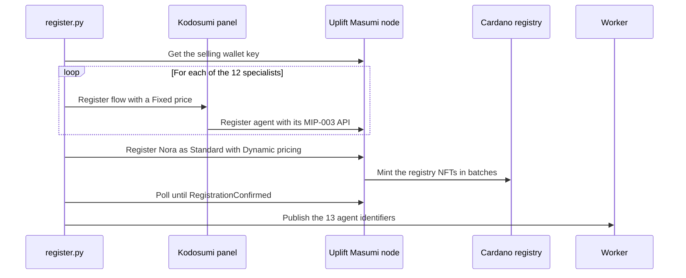

- The **12 specialists** register through the Kodosumi panel. Their MIP-003 API is their Kodosumi
  `/sumi/uplift/<name>` endpoint, at a **Fixed** price from the listing
  ([`register_specialists`](infra/masumi/register.py#L54-L79)).
- **Nora** registers directly on Uplift's payment node as a **Standard** agent with **Dynamic** pricing. Her API is
  the Worker's `/agents/nora` ([`register_nora`](infra/masumi/register.py#L89-L106)). She first registered as an
  `OpenApi` agent, and Sokosumi's buyer node couldn't resolve that type, so her first claim stuck at PENDING.
  [ISSUES.md §1](runs/ISSUES.md) records the diagnosis and the re-registration.
- The script waits for `RegistrationConfirmed` and then pushes the on-chain **agent identifiers** to the Worker
  ([`wait_confirmed` / `publish`](infra/masumi/register.py#L109-L140)). From then on, every payment request carries the
  agent's NFT identity ([`payments.py#L24-L35`](services/worker/src/uplift_worker/payments.py#L24-L35)).
- **Why it matters:** a buyer, or any other agent, can check on-chain who it is paying, what that agent's API is and
  how it prices, before a single unit moves. The NFT is the agent's passport.
- Proof: the 13 identifiers and their minting transactions are [listed above](#1-agent-identities-13-registry-nfts).

### C2 · Uplift's own Masumi payment node

Uplift doesn't borrow someone else's node. It **runs its own Masumi Payment Service** for Cardano preprod.

- It's pinned to an exact upstream commit and patched to migrate and seed on start, with the seed's wallet mnemonics
  silenced ([`deploy.sh`](infra/mps/deploy.sh)).
- It reaches the chain through **Blockfrost**, using payment source type `Web3CardanoV2`. A selling wallet holds test
  ADA for registry minting.
- `AUTO_WITHDRAW_PAYMENTS` and `AUTO_WITHDRAW_REFUNDS` are on. Unlocked funds and refunds settle without anyone pressing
  a button.
- The Worker uses a **scoped ReadAndPay key**, not the admin key
  ([`config.py#L34-L38`](services/worker/src/uplift_worker/config.py#L34-L38),
  [`clients.py#L272-L278`](services/worker/src/uplift_worker/clients.py#L272-L278)).

### C3 · Seller terms that commit to the brief

Before any work, Uplift creates the **seller terms** on its node
([`request_terms`](services/worker/src/uplift_worker/payments.py#L24-L48)):

| Field | Value | Why |
|---|---|---|
| `agentIdentifier` | the role's registry NFT | Pays exactly this agent |
| `inputHash` | `sha256(brief)` | The merchant's request is committed on-chain, so the job can't be swapped later |
| `identifierFromPurchaser` | a fresh 10-byte nonce | Uniqueness per purchase |
| `payByTime` | now + 10 min | The buyer must lock quickly or the Task fails cleanly |
| `submitResultTime` | now + 6 h | Uplift must deliver a verified result in time or the buyer is refunded |
| `unlockTime`, `externalDisputeUnlockTime` | set by the node, forwarded verbatim | When the seller can collect; until when the buyer can dispute |
| `RequestedFunds` (Nora only) | tUSDM × 10⁶ (6 decimals) | The Dynamic amount: the bill for the specialists who passed |
| `metadata` | `{"taskId": …}` | Links the escrow back to the Sokosumi Task |

### C4 · Credits → tUSDM escrow (the Sokosumi bridge)

The merchant never touches a wallet.

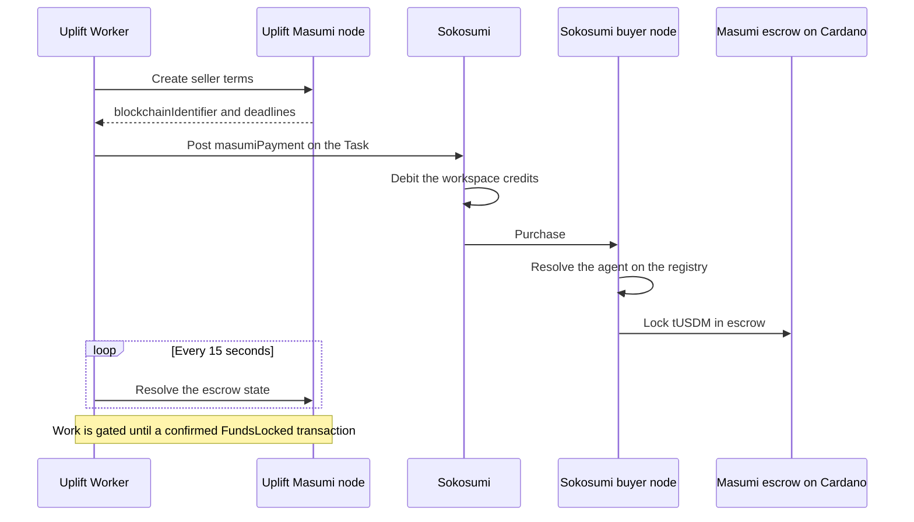

- Uplift posts the terms as a `masumiPayment` Task event
  ([`charge`](services/worker/src/uplift_worker/payments.py#L74-L83)) with everything the buyer needs: seller vkey,
  deadlines, amounts and the contract address and policy.
- Sokosumi debits workspace credits, and **its buyer node locks the matching tUSDM in the Masumi escrow
  contract** on Cardano (100 credits per tUSDM).
- Retries reuse the journaled terms until their pay-by deadline, instead of opening a second escrow. An empty
  workspace becomes `OUT_OF_CREDITS` cleanly ([`pay`](services/worker/src/uplift_worker/payments.py#L86-L100)).

### C5 · On-chain gating: nothing goes live until the lock is confirmed

The Worker doesn't trust "payment requested". It resolves the `blockchainIdentifier` on the node and requires a
**Confirmed** transaction whose new state is `FundsLocked`
([`_confirmed` / `funds_locked`](services/worker/src/uplift_worker/payments.py#L103-L126)).

- **Specialists:** a Chainlink PASS waits in `funds_wait` until the lock is confirmed
  ([`specialist.py#L145-L155`](services/worker/src/uplift_worker/specialist.py#L145-L155)).
- **Nora:** `publish` and `deliver` both wait for it
  ([`nora.py#L285-L293`](services/worker/src/uplift_worker/nora.py#L285-L293)).
- **No lock by the pay-by deadline** (+5 min grace): the Task fails cleanly with "nothing was published or delivered"
  ([`lock_expired`](services/worker/src/uplift_worker/payments.py#L109-L111)).

**Latency without risk.** The agent starts working *while* the lock confirms. Cardano adds no wait to the merchant's
experience, yet it is a hard gate on the merchant's store and on delivery.

### C6 · The result hash: Chainlink's verdict, anchored on Cardano

After delivery, Uplift calls `submit-result` with **`submitResultHash` = the content address of the manifest that
Chainlink verified** ([`submit_result`](services/worker/src/uplift_worker/payments.py#L138-L144),
[`specialist.py#L270-L276`](services/worker/src/uplift_worker/specialist.py#L270-L276)).
The escrow moves to `ResultSubmitted`. That datum now names, immutably, the exact files the merchant paid for.
Anyone can fetch `artifacts/<hash>/manifest.json`, re-hash it and compare.

Proof, from run 16:

| Step | Evidence |
|---|---|
| Brief committed | `inputHash 38830730d6e9f71b…` in the seller terms ([trace](runs/16-clara-bamboo-traced/trace.json)) |
| Escrow locked | [`6e2fdc39…`](https://preprod.cexplorer.io/tx/6e2fdc392abc64c0cbab90c562d12db23092d31bbe39bc97cc38d6fcc6976868) |
| Deliverable stored at its hash | `artifacts/97028d8f60cb9b5f64690e7b7a1cae451531752a82717bd620c338d233f3d2a2/manifest.json` |
| Chainlink verified that hash | **PASS 92.5/100** |
| Store changed through CRE only | 2 changes applied, score 72.2/95 |
| Same hash on-chain | [`a00e66f5…`](https://preprod.cexplorer.io/tx/a00e66f5b8aee6e1f5af699788fd0158377e3250d6ce23283beae99e1cb1ac2e) |

For Nora, the submitted hash covers the CRE publish result: the whole team's outcome, which lists what was applied and
the after score.

### C7 · Pay only for proven work (Dynamic pricing)

Nora's registry entry uses **Dynamic** pricing. One escrow is opened **after** the team has run, for the sum of the
specialists who passed Chainlink, capped by the quote the merchant approved.

In run 00, two of Leo's Chainlink checks failed, so his work was left out and the escrow locked **7.25** tUSDM instead
of the full quote ([lock](https://preprod.cexplorer.io/tx/2288fd5a171646d5fe8745c487a46df93b70d90c4b7c283fcbee4ff6d786c39b) ·
[result](https://preprod.cexplorer.io/tx/f04f5d41f5086b6b2ba345b0f5bf80b1f49ed0c96f75e28340c067e2b83dfba3)).

### C8 · Refunds are on-chain, not a support ticket

If the merchant declines a change set, or a run fails, **Uplift never submits a result**. Once the submit deadline
passes, the escrow returns the tUSDM to the buyer and the node's auto-withdraw collects it. Eight refunds are on-chain
in this test, for example:

- Marcus declined: [`3a555c02…`](https://preprod.cexplorer.io/tx/3a555c02c50ef458ebadec825e46880247ee984bf8041c41c8228475cb017f73)
- Oskar declined: [`e2f35ff1…`](https://preprod.cexplorer.io/tx/e2f35ff11e8ca92d80ffca62c54df5446215729c93d1cde90dd8e3ed5f42dfcf)
- Five duplicate Tasks: see the [escrow table](#2-every-escrow-oldest-first)

No support ticket, no promise from a vendor: the contract's own deadline returns the money.

### C9 · Deadlines, payouts and the dispute window

A submitted result unlocks for the seller after `unlockTime`, and the buyer can still dispute until
`externalDisputeUnlockTime`. The Masumi contract enforces the whole lifecycle, not Uplift's database. Here are the
real deadlines of one escrow from the test, on 2026-10-07:

| Deadline | Time (UTC) | What happens |
|---|---|---|
| Payment requested | 02:05 | Uplift creates the seller terms |
| `payByTime` | 02:15 | The buyer must have locked the funds, or the Task fails cleanly |
| `submitResultTime` | 08:05 | Uplift must have submitted the verified result hash, or the buyer is refunded |
| `unlockTime` | 14:05 | The seller can withdraw; Uplift's node auto-withdraws |
| `externalDisputeUnlockTime` | 20:05 | Until now the buyer can still dispute the result |

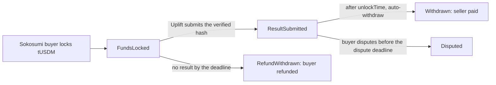

### C10 · Batching: fewer transactions per Task

The payment node batches escrow operations. **43 escrows were locked in 16 transactions.** For example, Quinn, Kai,
Rafael, Priya, Sasha and the first Marcus attempt all locked in
[`24816fbd…`](https://preprod.cexplorer.io/tx/24816fbdde55e00784b06a508ff01a78086b8468690a251aa2ced6ae6e5917f8).
A Nora run with ten specialists, or a merchant hiring five coworkers at once, settles in a handful of transactions.
That keeps fees down as volume grows.

### C11 · Cardano in the product UI

- **`/live` escrow card.** For any Task, the Worker's [`/trace/escrow`](services/worker/src/uplift_worker/trace_api.py#L116-L159)
  resolves the escrow on the node. It returns:
  - the amount and state
  - every transaction, with block height, block time, confirmations and fee in lovelace
  - the contract address
  - every deadline

  [`escrow.tsx`](landing/app/live/escrow.tsx#L36-L131) shows it as a timeline with explorer links that refresh every
  10 seconds.
- **Live trace events** `masumi.terms` → `payment.charged` → `cardano.escrow` (lock confirmed, with the tx hash) →
  `masumi.result` are emitted as they happen
  ([`payments.py`](services/worker/src/uplift_worker/payments.py#L39-L144)), so the merchant can watch the lock land.
- **Audit from the terminal.** [`e2e/payments.py`](e2e/payments.py) lists every escrow with its transactions and
  cexplorer links. That's how the tables in this README were made.

### C12 · Sokosumi: the storefront on top of Masumi

All 13 agents are **Sokosumi coworkers**, with listings, avatars, prices and a chat endpoint
([`coworkers.json`](infra/sokosumi/coworkers.json), [`register.py`](infra/sokosumi/register.py)). Sokosumi gives
merchants a credit-card-simple experience. Underneath, every credit spent becomes tUSDM in a Cardano escrow that
names an Uplift agent NFT. That is how Cardano reaches merchants who will never install a wallet.

### Cardano identifiers

| What | Value |
|---|---|
| Network | Cardano **preprod**, payment source `Web3CardanoV2` |
| Masumi escrow contract | [`addr_test1wzs4e6wc95hkwezlccjw9mdvq0r0rsgx6zk34avptga3ftgn37w4g`](https://preprod.cexplorer.io/address/addr_test1wzs4e6wc95hkwezlccjw9mdvq0r0rsgx6zk34avptga3ftgn37w4g) |
| Registry / payment-source policy | [`67ab0c92c4ac1610895a1c965ee50aba41a8f1513b15240723b3bd0b`](https://preprod.cexplorer.io/policy/67ab0c92c4ac1610895a1c965ee50aba41a8f1513b15240723b3bd0b) |
| Settlement asset (tUSDM) | `16a55b2a349361ff88c03788f93e1e966e5d689605d044fef722ddde` · `0014df10745553444d` |
| Uplift payment node | `https://mps-production-d96b.up.railway.app` |
| Explorer | [preprod.cexplorer.io](https://preprod.cexplorer.io) |

---

## Chainlink CRE: the referee

If Cardano is where the money settles, **Chainlink CRE decides whether it should**. The workflow `uplift-clearing`
([`main.ts`](cre/uplift-clearing/main.ts)) is one HTTP-triggered workflow with two actions. It's written in TypeScript
with `@chainlink/cre-sdk`, compiled to WASM, and it reports back to the Worker by callback.

### Triggering

- The Worker signs each request as a **JWT signed with an Ethereum key**. The JWT binds the sha256 of the request
  body and expires in 240 seconds ([`cre.py#L34-L46`](services/worker/src/uplift_worker/cre.py#L34-L46)). The
  workflow accepts only the keys in its `authorizedKeys` ([`main.ts#L145-L149`](cre/uplift-clearing/main.ts#L145-L149)).
- **Two modes, one code path:**
  - **Deployed:** JSON-RPC `workflows.execute` to the CRE gateway.
  - **Today:** `cre workflow simulate` runs the same workflow inside the Worker container
    ([`cre.py#L49-L111`](services/worker/src/uplift_worker/cre.py#L49-L111)). The CRE CLI is baked into the
    [Worker image](services/worker/Dockerfile).
  - Switching to a DON is a single variable, `CRE_TRIGGER_URL`.
- Results come back to `/hooks/cre` and land in the `cre_results` table.

### `verify`: is this deliverable real, and is it good?

([`main.ts#L25-L66`](cre/uplift-clearing/main.ts#L25-L66))

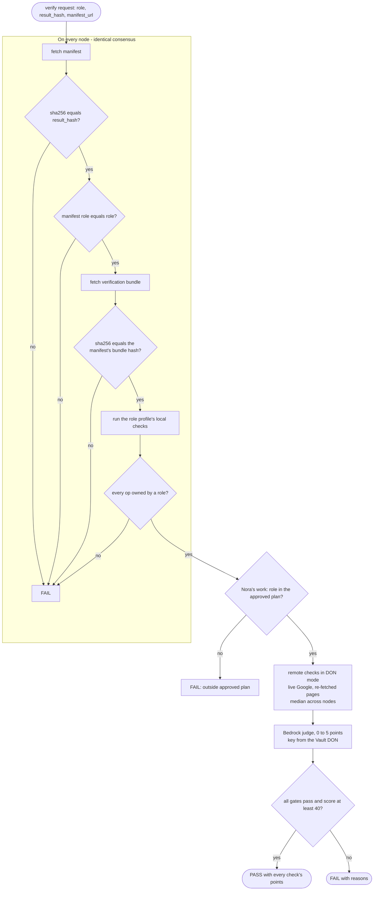

1. **Re-fetch and re-hash on every node.** Each node downloads the manifest and checks
   `sha256 == result_hash`, then the verification bundle against the hash the manifest names
   ([`fetchVerified`](cre/uplift-clearing/src/lib.ts#L81-L86)). The nodes must agree byte for byte
   (`consensusIdenticalAggregation`, [`onNodes`](cre/uplift-clearing/src/lib.ts#L69-L72)).
2. **Role and ownership.** The manifest's role must match the role being paid. Any op touching a field no role owns
   fails at once.
3. **Plan check.** For Nora's work, the role must appear in the plan the merchant approved
   ([`planRoles`](cre/uplift-clearing/main.ts#L17-L23)).
4. **Role profile.** Each of the 12 roles has a profile with **local** checks, which are deterministic and run on
   every node, and **remote** checks, which re-test the live web
   ([`profiles.ts`](cre/uplift-clearing/src/profiles.ts#L496)). Live web probes (search positions, autocomplete,
   quoted pages) take the **median** across nodes ([`medianOnNodes`](cre/uplift-clearing/src/lib.ts#L76-L78)), since
   pages differ slightly from node to node.
5. **Judge.** One Bedrock LLM judgement worth up to 5 points ([`judge`](cre/uplift-clearing/src/lib.ts#L90)). Its API
   key is a **Vault DON secret** and travels through Confidential HTTP ([`call`](cre/uplift-clearing/src/lib.ts#L29-L51)).
6. **Verdict.** PASS needs every gate to pass and a score of at least **40**. The response lists each check's points,
   so the merchant sees *why*.

### `publish`: the only door into the store

([`main.ts#L91-L125`](cre/uplift-clearing/main.ts#L91-L125))

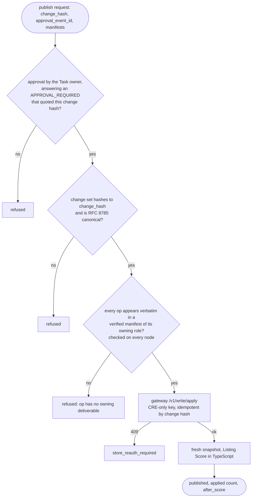

1. **Approval is real.** The approval event must come from the **Task owner**, and it must answer an
   `APPROVAL_REQUIRED` that quoted **this change hash** ([`approvalProblem`](cre/uplift-clearing/main.ts#L80-L89)). A
   stale approval, an approval for a different change set or an approval written by anyone else is refused.
2. **Integrity.** The change set must hash to `change_hash` and be in RFC 8785 canonical form.
3. **Provenance.** Every op must appear verbatim (by hash) in a verified manifest of the role that owns that field.
   If it doesn't, the publish is refused. Uplift's own Worker can't slip in an edit.
4. **Write.** CRE calls the gateway's `/v1/write/apply` with a key only the workflow holds. The call is idempotent by
   change hash, and a revoked store returns `store_reauth_required`.
5. **Re-score.** CRE takes a fresh snapshot and computes the deterministic Listing Score in TypeScript
   ([`core.ts#L75`](cre/uplift-clearing/src/core.ts#L75)). That `after_score` is what Nora reports.

### What CRE protects against

| Attack or failure | Stopped by |
|---|---|
| An agent swaps a file after it was verified | The content address changes, so verify, publish and the on-chain hash all disagree |
| An agent invents a feature in the copy | Clara's **Fact grounding** check and Ruth's rules engine |
| An AI render that doesn't look like the product | Iris's **Product fidelity** check (≥ 0.90) |
| An ad bid that loses money per sale | Sasha's **Bid safety**, recomputed from the store's own price and margin |
| A fake keyword, quote or ranking | Remote checks against the live web, median across nodes |
| Nora runs a specialist the merchant didn't approve | The plan check, which fails as "outside approved plan" |
| Someone edits the change set after approval | The approval must quote the change hash, and the hash must match |
| The Worker (Uplift itself) slips in an edit | The provenance check: every op must come from a verified deliverable |
| A role writes a field it doesn't own | The ownership map in [`core.ts`](cre/uplift-clearing/src/core.ts#L33-L56) |

### Python ↔ TypeScript, in lockstep

Hashes, rule hits and the Listing Score are computed on both sides: agents in Python, CRE in TypeScript.
[`e2e/cre_parity.py`](e2e/cre_parity.py) and [`parity.ts`](cre/uplift-clearing/parity.ts) assert identical outputs,
so a PASS in CRE means the same thing as a PASS in the agent's own self-check. The rules file is literally the same
file on both sides ([`uplift-rules.json`](rules/uplift-rules.json), imported by
[`core.ts`](cre/uplift-clearing/src/core.ts#L2) and loaded by [`rules.py`](packages/core/src/uplift_core/rules.py#L22-L46)).

---

## Roadmap

| When | Milestone | What it unlocks |
|---|---|---|
| **Now → Next** | **Every merchant's own Shopify store.** Today Uplift runs end to end on our Shopify demo store: a merchant connects it through the gateway's OAuth flow and every agent reads from it and publishes to it through Chainlink. Next, the Shopify app goes to public distribution so any merchant can connect their own store in one click and hire the team on it. | Uplift on real merchants' stores |
| **Next** | **Mainnet.** Move settlement to mainnet USDM on Cardano (the unit is already documented in [`docs/research`](docs/research)) and the Sokosumi listings to production. | Real merchants, real revenue |
| **Next** | **Deploy `uplift-clearing` to a Chainlink DON.** The trigger path, JWT auth and Vault secrets are already in place; only `CRE_TRIGGER_URL` changes. | Verification by independent node operators, not a simulator |
| **Next** | **Real Google Ads push.** Sasha's verified Editor file goes to the Google Ads API through the CRE publish path, still Paused by default. The [mock](ads-mock/README.md) becomes the preview step. | One-click launch of verified campaigns |
| **Soon** | **Verifiable deliverable receipts.** A CIP-68 receipt per Task that points to the content-addressed manifest and the CRE verdict. | Merchants carry proof of their listing's provenance |
| **Later** | **Hydra heads for high-frequency work.** Rank checks, price watches and ad-bid tweaks are tiny, frequent jobs. | Per-job fees near zero |
| **Later** | **More channels.** Amazon, Meta Ads and TikTok Shop specialists, each with its own CRE profile. | Growth wherever the merchant sells |

---

## Conclusion

Most AI agents for e-commerce and ads ask merchants for trust. **Uplift asks for none.**

Every agent has an **identity on Cardano**. Every Task's payment sits in a **Cardano escrow** that commits to the
merchant's brief. Every deliverable is **content-addressed**, then **verified by Chainlink CRE** across nodes that
must agree byte for byte. Every store change goes through **one door that only Chainlink holds the key to**, and only
after the merchant approves that exact hash. The same hash that Chainlink verified is the one **written back to
Cardano** as the result. Work that fails isn't billed. Work that's declined is **refunded on-chain**.

This is not a slide. It ran this week:

- 13 agents minted on Cardano preprod
- 43 escrows and 45 transactions
- 96 tUSDM of verified work settled, 13.5 tUSDM refunded
- a listing taken from 27.1 to 72.9

**Uplift is what the agent economy looks like when payment, proof and permission settle on the same chain.**

<div align="center">

*Built with Cardano · Masumi · Sokosumi · Kodosumi · Chainlink CRE · Shopify*

</div>
