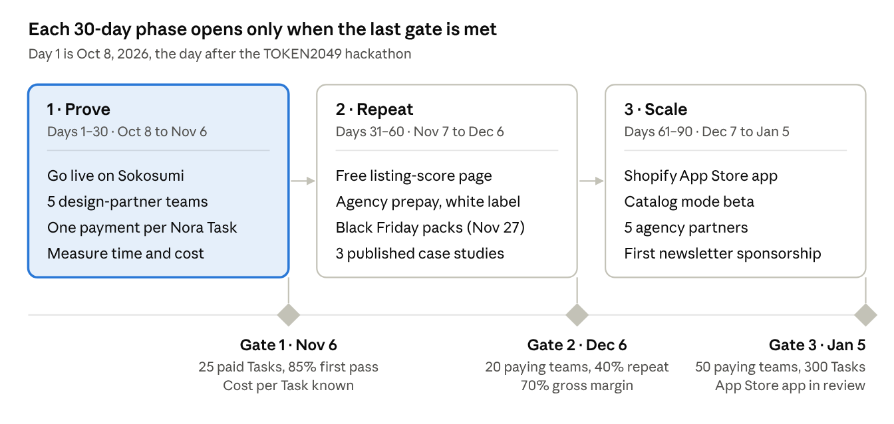

# Uplift Go-to-Market Plan

Oct 7, 2026 · Online version: [Uplift Go-to-Market Plan](https://claude.ai/code/artifact/ce5cea17-2659-46a6-95dc-4fb5825d1026)

**Recommendation:** launch Uplift as a *verified AI growth team* for European agencies and brand e-commerce teams that launch hero products and new markets on Shopify. Sell through Sokosumi and direct agency partnerships first. Lead with the full launch at $29–$49 and a “pay only for work that passes Chainlink” guarantee, and use a free listing score as the funnel.

**Order of moves:** build the Shopify App Store version, billed through Shopify, as the volume channel for small merchants once 20 teams pay and 40% come back. The 90-day target is 50 paying teams, 300 paid Tasks and an App Store app in review.

**Fix first:** the spec's one-payment-per-Task design, to cut run time, and a catalog mode for multi-product stores.

## Product: what Uplift actually sells

Uplift sells a finished, published listing upgrade, not a tool: one request becomes a researched, rewritten, re-shot, translated and ad-ready product page, approved once and published to the store, with every piece checked before it is billed.

**What is genuinely different** (verified in the codebase and specs):

| Property | How it works today | Why a merchant cares |
| --- | --- | --- |
| Outcome, not a tool | Nora plans the work, hires up to 12 specialists in dependency order, merges one change set and publishes it after one approval | Replaces 5–7 separate apps or a freelancer chain, and no one has to stitch the outputs together |
| Pay only for verified work | A Chainlink workflow re-fetches cited sources, recomputes the maths and scores each deliverable against a role rubric; failed work is redone once and never billed | Removes the main fear about AI output: paying for confident nonsense |
| Safe by design | Never changes price, inventory, variants, theme or orders; ads are created paused; agents never hold store credentials; the merchant approves the exact change hash | Low-risk first purchase, even for a store owner who has been burned before |
| Grounded in real data | Google autocomplete, search and Shopping results, competitor pages, Amazon and Reddit reviews; AI images are checked against the real product photo (fidelity ≥ 0.90) | Recommendations a merchant can audit, not generic copy |
| Priced per task | Focused fix of one product page ≈ 6 credits; full launch of one product in 2 languages ≈ 18–20 credits; single specialists 0.25–2.50 credits | Usable without a subscription or an agency retainer |

**Not ready to sell yet.** These are gates in the launch plan, not reasons to wait:

- **Test rails only.** Sokosumi is on preprod and escrow uses test USDM on Cardano Preprod, so there is no revenue path until production.
- **One product per Task.** Nora works on the first matching product, but the target merchant has 10–2,000 products. A catalog mode (batching and per-product pricing at volume) is the biggest product gap.
- **Slow end-to-end.** Every specialist is an escrowed Job, and a full launch runs 7–8 Jobs in sequence. The new timing logs will show the real duration; set expectations (“ready in about an hour”) until it is measured.
- **Lives inside Sokosumi only.** A merchant must find and use Sokosumi to buy, and the Shopify app is not on the Shopify App Store.
- **Unmeasured unit cost.** Each run pays for LLM calls, image generation, search, scraping and review data. That cost per Task has not been measured, so margins are unknown.

## Market: big, growing, and being rewired for AI shoppers

Shopify is a large, fast-growing base of merchants who already buy their growth work from apps and freelancers. AI shopping channels are now raising the value of a complete, well-structured listing.

| Fact | Figure | Source |
| --- | --- | --- |
| Shopify GMV, FY2025 | $378.4B, up 29% | [10-K FY2025](https://www.sec.gov/Archives/edgar/data/1594805/000159480526000007/shop-20251231.htm) |
| Shopify GMV and revenue, Q2 2026 (Apr–Jun) | $115.6B GMV (up 32%); $3.58B revenue (up 34%) | [Q2 2026 release](https://www.sec.gov/Archives/edgar/data/0001594805/000159480526000046/exhibit991pressreleaseq220.htm) |
| Live Shopify stores, Oct 2026 | 3.10M (up 15% a year); 80,050 on Shopify Plus | [Store Leads](https://storeleads.app/reports/shopify) (third-party count) |
| Merchants by region, Dec 2025 | 44% US, 31% EMEA, 16% APAC, 5% Canada, 5% LatAm | [10-K FY2025](https://www.sec.gov/Archives/edgar/data/1594805/000159480526000007/shop-20251231.htm) |
| App ecosystem | 21,000+ apps; $1.3B paid to developers last year | [10-K](https://www.sec.gov/Archives/edgar/data/1594805/000159480526000007/shop-20251231.htm), [Shopify News](https://www.shopify.com/news/billion-dollar-ecosystem) |
| Merchants planning AI for content (2024 survey of 13,337) | 50% for content, 33% for SEO and targeting | [Shopify News](https://www.shopify.com/news/ai-tools-for-business) |
| Orders from AI search on Shopify | Up 15x from Jan 2025 to the Q4 2025 call | [Digital Commerce 360](https://www.digitalcommerce360.com/2026/02/17/shopify-revenue-gmv-q4-2025/) |

**Why now.**

- **AI shopping agents read product data.** In Jan 2026 Shopify launched Agentic Storefronts, which sell in ChatGPT, Gemini, Copilot and Google AI Mode, and co-launched the Universal Commerce Protocol with Google ([Shopify News](https://www.shopify.com/news/ai-commerce-at-scale)). In Sep 2026 it opened checkout to browser agents ([TechCrunch](https://techcrunch.com/2026/09/28/shopify-opens-checkout-to-browser-based-ai-agents/)). Complete attributes, a correct category, keyword-rich copy and alt text are now ranking inputs for AI channels as well as Google.
- **Merchants pay for agents.** Salesforce Agentforce passed $1.5B ARR, up more than 240% a year ([Salesforce IR](https://investor.salesforce.com/news/news-details/2026/Salesforce-Delivers-Record-Second-Quarter-Fiscal-2027-Results/default.aspx)).
- **Shopify's free AI stops short.** Magic does not write SEO titles or meta descriptions ([feature table](https://apps.shopify.com/built-in-features/magic-product-descriptions)). Sidekick's documented features include no keyword research, no competitor research, no Google Ads builds and no end-to-end translation ([Sidekick help](https://help.shopify.com/en/manual/shopify-admin/productivity-tools/sidekick/features)).

**The work pays off.** 76% of shoppers prefer to buy in their own language and 40% never buy from sites in other languages ([CSA Research](https://csa-research.com/Blogs-Events/CSA-in-the-Media/Press-Releases/Consumers-Prefer-their-Own-Language), 2020). 54% abandoned a purchase over conflicting product information ([Salsify](https://www.salsify.com/press-release-salsify-2025-consumer-research-report), vendor survey). 62% of mobile product pages have mediocre or worse UX ([Baymard](https://baymard.com/research-articles/current-state-ecommerce-product-page-ux?r=0)).

**Sizing (assumptions, not sourced).** Suppose 10% of the 3.10M live stores are active businesses with 10–2,000 products. That is about 310,000 stores. At four full launches a year at $39, that is a serviceable market of about $48M a year, before catalog refreshes and agencies. Shopify publishes no merchant count by catalog size, so validate the 10% with Store Leads data before using this figure externally.

## Who to sell to first: agencies and in-house e-commerce teams, then small merchants

Start with agencies and brand e-commerce teams that launch hero products and new markets on Shopify, reached through Sokosumi. Move to the spec's small-merchant ICP only once a Shopify App Store version exists. Three facts force this order:

- **Sokosumi's buyers are marketing teams at large companies.** Its homepage names Deutsche Telekom, Allianz, Lufthansa, ARD and Serviceplan ([sokosumi.com](https://www.sokosumi.com)), not small Shopify shops.
- **Small merchants are reachable at scale only through the Shopify App Store**, and the App Store bars apps that bill off-platform ([requirement 1.2.1](https://shopify.dev/docs/apps/launch/shopify-app-store/app-store-requirements)).
- **Uplift works on one product per Task.** That suits hero-product launches, not 500-SKU catalogs.

| Segment | How big | What they pay for today | Reach today | Fit today | Verdict |
| --- | --- | --- | --- | --- | --- |
| Agencies running Shopify client stores | Shopify's Partner Directory covers 40+ countries; Serviceplan, which built Sokosumi, is itself an agency group | Freelancers and staff at $2,000–$5,000/mo per small client | Sokosumi, Serviceplan network, direct outreach | High: per-task work, verified deliverables to show clients, white-label launch packs | **Beachhead 1** |
| In-house e-commerce teams at brands | 80,050 Shopify Plus stores | Agencies, tool stacks, staff time | Sokosumi enterprise users, mainly DACH | High for hero products and new EU markets; claims review matters to regulated brands | **Beachhead 2** |
| Merchants entering new countries | 31% of Shopify merchants are in EMEA, 16% in APAC | Translation apps at $12–$99/mo, translators at $0.09–$0.25/word | Same as above | High: local keywords plus translations published into the store | Lead use case across segments |
| Small merchants with 10–2,000 products | About 310,000 stores (assumption in Market) | $15–$99/mo apps; free Sidekick | Needs a Shopify App Store app with Shopify Billing | Medium until catalog mode ships | **Phase 2** |
| Dropshippers and one-week stores | r/dropship has 361k members | As little as possible | Communities | Low: price-driven, little interest in verified quality | Avoid |

**Beachhead profile:** a European agency or brand e-commerce team that launches a few hero products a month on Shopify, often into 2–3 EU languages. They have to show a client or a manager that the work is sound and claims-safe.

**Jobs they hire Uplift for**, each mapped to an existing Nora request:

1. Launch a new product fast (“Launch my new bamboo bottle”).
2. Take a product into a new market (“Sell this in Germany and Japan”).
3. Fix a product that isn't selling (“Why isn't this product selling?”).
4. Prepare a seasonal push (“Plan our Black Friday promotion”).

## Competition: crowded at the tool level, empty at the verified-team level

Every individual job Uplift does is already sold cheaply by a Shopify app, and Shopify now gives basic copy, studio shots and translation away free. Nobody sells the whole listing as one approved, independently verified, refundable outcome.

| Category | Leaders (App Store rating, reviews) | Price | What they lack against Uplift |
| --- | --- | --- | --- |
| Shopify built-in | [Sidekick](https://www.shopify.com/sidekick) (copy, SEO text, studio shots, discounts, collections); [Translate & Adapt](https://apps.shopify.com/translate-and-adapt) (4.4, 1,408); Campaign Autopilot ([Summer '26](https://shopappy.com/ecommerce/shopify-editions-summer-26-what-shopify-actually-announced), Meta, Shop app and email ads after approval) | Free | No market or review research, no single sign-off across workstreams, no Google Ads build or feed step, no independent check. **Biggest threat** |
| SEO and listing apps | [Booster](https://apps.shopify.com/seo-image-optimizer) (4.8, 5,484), [Avada](https://apps.shopify.com/avada-seo-suite) (4.9, 4,684), [TinySEO](https://apps.shopify.com/smart-image-optimizer) (5.0, 2,531), [StoreSEO](https://apps.shopify.com/storeseo), [Smart SEO](https://apps.shopify.com/smart-seo) | $14–$99/mo | Metadata, alt text and schema at scale; no research, images, translation or ads, no verification |
| AI copy | [StoreYa AI descriptions](https://apps.shopify.com/product-description-ai) (4.8, 371), [Describely](https://describely.ai/pricing), [Jasper](https://www.jasper.ai/pricing) | $15–$100/mo; $0.75/product; $69/seat | Copy only, not grounded in competitor or review data |
| AI images | [Photoroom](https://www.photoroom.com/pricing), [Pebblely](https://pebblely.com/pricing), [Flair](https://flair.ai/pricing) | $8–$49/mo; API $0.02–$0.10/image | No fidelity check against the real product at SMB prices |
| Translation | [Weglot](https://apps.shopify.com/weglot) (4.5, 830), [Transcy](https://apps.shopify.com/transcy-multiple-languages) (4.5, 2,577), [T Lab](https://apps.shopify.com/content-translation) (4.9, 1,036) | $12–$99/mo | Machine translation without local keyword research |
| Feeds and ads | [Simprosys](https://apps.shopify.com/google-shopping-feed) (4.9, 4,912), [Google & YouTube](https://apps.shopify.com/google) (free), [AdScale](https://apps.shopify.com/adscale) (4.7, 373) | $5–$329/mo | One channel each; nothing upstream of the feed or the ad |
| AI “teams” | [Sintra](https://www.eesel.ai/blog/sintra-ai-pricing) (12 general helpers), [EcoAgents](https://apps.shopify.com/saara-ai-agents), [agentShop](https://apps.shopify.com/agentshop) (approval plus 30-day undo), [ShopChief](https://aiagentsdirectory.com/agent/shopchief) (listed 2026-09-30) | $0–$399/mo | Closest in concept and the ones to watch; none verifies work or refunds failures, and EcoAgents does not publish |
| People | Freelancers and agencies ([photos](https://www.shopify.com/blog/product-photography-pricing), [translation](https://translayte.com/blog/how-much-does-a-translator-cost-in-2024), [Ads setup](https://clicksgeek.com/ppc-campaign-setup-cost/), [agency retainers](https://tenten.co/shopify/shopify-agency-pricing-2026/)) | About $300–$1,350 per product for copy, 3 images, 2-locale translation and an hour of SEO (estimate); Ads setup $800–$5,000; small-store retainers $2,000–$5,000/mo | Slow, variable quality, no per-result guarantee |

**Where Uplift wins:** one approval across copy, images, catalog, translations, discounts and ads; an independent check of every deliverable; payment only for work that passed, with failures refunded; an image fidelity check; competitor and review research that feeds the copy; a claims and compliance review; a before/after listing score. No product in this table offers more than two of these.

**Where it loses today:** Shopify gives the basic version away free inside the admin, the incumbents have thousands of reviews, and every app above works across a whole catalog while Uplift works on one product per Task. Upwork and Fiverr rates could not be verified (both blocked the request).

## Positioning and messaging: the verified AI growth team

**Promise:** “Your next product launch, researched, built and published by an AI growth team. Every deliverable is independently checked, and you only pay for work that passes.”

Position Uplift as a new category, a *verified AI growth team*. It is neither another AI tool, which competes with free Sidekick, nor a cheap agency, which invites a quality comparison. Lead with the outcome and the guarantee. Use “verified by Chainlink” as the proof badge, and keep Cardano, Masumi and escrow out of merchant-facing copy: buyers pay in credits and never see the chain.

| Pillar | Message | Proof the buyer can see |
| --- | --- | --- |
| Complete | One request, one approval: copy, images, catalog and feed, translations, discounts and paused Google Ads | The launch pack and the change diff attached to the Task |
| Verified | Every deliverable is checked against sources, maths and compliance rules before it is billed | Chainlink's verdict and score posted on the Task for each specialist |
| Safe | Nothing changes until you approve the exact change set; prices, inventory and theme are never touched; ads start paused | The approval step and the change hash in the comment |
| Measurable | Before/after listing score on every Task | Quinn's report; add Google rank and 30-day sessions in case studies |

**Messages by audience:**

- **Agencies:** “Ship client launches the same day, with proof every deliverable was checked. Resell the launch pack under your name.”
- **Brand e-commerce teams:** “Launch hero products and new EU markets without a brief, a freelancer chain or a claims risk.”
- **Small merchants (phase 2):** “An agency-grade launch for the price of a lunch. If it fails the check, it's free.”
- **Builders and ecosystem (hackathon, Chainlink, Masumi):** lead with the technology, “multi-agent commerce where an independent workflow decides what gets paid and published.”

**Objections and answers:**

| Objection | Answer |
| --- | --- |
| “Sidekick does this for free.” | Sidekick drafts what you ask for. Uplift researches competitors and real search demand, builds the feed, translations and Google Ads, and gets every piece checked independently. |
| “AI copy is generic.” | Copy is built from real search terms and competitors' customer reviews, and Chainlink fails copy whose claims aren't grounded in product facts. |
| “Will it break my store?” | It never changes price, inventory, variants or theme. You approve one exact change set, and ads are created paused. |
| “What if the work is bad?” | Work that fails the check is redone once, and never billed if it fails again. |
| “Do I need crypto?” | No. You pay with Sokosumi credits; settlement happens behind the scenes. |
| “How long does it take?” | Quote the measured time from the timing logs, not a guess. |

## Pricing and packaging: keep per-task, anchor on people, raise the full launch

Keep pay-per-task with the “pay only for verified work” guarantee, but price against the freelancers it replaces, not against $15 apps. A full launch at today's list (about $19.50) is 1.4–6.5% of the roughly $300–$1,350 a merchant pays people for the same product, so the risk is underpricing.

**Currency check first.** Uplift lists prices in USDM (about $1 each), and the spec assumes 1 Sokosumi credit = 1 USDM. Sokosumi's public plans imply about €0.013–€0.017 per credit ([Starter €25 for 1,500 credits, Pro €200 for 15,000](https://www.sokosumi.com/pricing); our calculation, not an official rate). If Sokosumi converts USDM at that rate, a $19.50 launch costs a buyer about 1,150–1,500 credits, most of a Starter month. Confirm the conversion and Sokosumi's take rate with Sokosumi; [its terms](https://www.sokosumi.com/legal/terms-of-service) state no take rate.

| Package | What it includes | List today | Recommended price to test | Anchor the buyer sees |
| --- | --- | --- | --- | --- |
| Free listing score | Quinn's 0–100 audit of one product with a prioritized fix list | 0.50 | Free, one per store | Lead magnet; every audit ends in a quote |
| Focused fix | Keywords, competitor reviews, copy, compliance, before/after score for one product page | ≈ 6.00 | $9–$12 | A freelance description ($3–$18) plus an hour of SEO ($75–$200) |
| Full launch | All specialists for one product, copy, images, feed, 2 languages, content, paused Google Ads, publish | ≈ 19.50 | $29 and $49 (A/B) | $300–$1,350 of freelance work; a $126–$552/mo tool stack |
| Market entry | One product into one new language with local keywords | 1.00 per locale | $2 per locale | Machine-translation apps at $12–$99/mo, without local keyword research |
| Catalog refresh (needs catalog mode) | Shared research per collection, then copy, alt text and feed fixes per product, 25-product minimum | n/a | $3–$5 per product | Describely at $0.75/product (copy only) vs an agency project |
| Agency prepay | Prepaid credits at 15–20% bonus, white-label launch packs | n/a | From $500 | Agency margin on resold work |

- **Make the guarantee the headline:** “Chainlink checks every deliverable. If it fails, you don't pay.” It is built into the product and no competitor offers it.
- **No subscription yet.** Per-task pricing matches the “one request, one result” promise and avoids head-on comparison with free Sidekick and $39/mo apps. Add bundles and agency prepay before any monthly plan.
- **Measure cost per Task before fixing prices.** Each run pays for LLM calls, image generation, search, scraping and review data. Log the cost next to the new timing logs, and hold full-launch gross margin at 70% or more.

## Channels: Sokosumi and agencies first, the Shopify App Store second

Win the first 20 paying teams through Sokosumi and agency partnerships, where the product already lives and fits. Use free audits and content to fill both. Build the Shopify App Store version, with Shopify Billing, in parallel as the volume channel for small merchants.

| Rank | Channel | Who it reaches | What to do | Cost and catch |
| --- | --- | --- | --- | --- |
| 1 | Sokosumi marketplace | Marketing teams at large European companies; launched by Serviceplan/Plan.Net in Jun 2025 ([press](https://www.house-of-communication.com/de/en/newsroom/2025/06/plan-net-launch-sokosumi.html)) | Go live on production; get Nora featured; publish ready-made Task templates per job (launch, new market, fix, Black Friday) | Low cost. Sokosumi publishes no user or job numbers, and the [Catalyst target](https://projectcatalyst.io/funds/14/cardano-use-cases-partners-and-products/masumi-ai-agent-network-20-by-serviceplan-group) is 25,000 users, so demand is unproven |
| 2 | Agency partners | Agencies running Shopify client stores, starting with Serviceplan's network and the [Partner Directory](https://www.shopify.com/partners/directory) | White-label launch packs, agency prepay with 15–20% bonus credits, 20% recurring referral ([Shopify pays agencies 20%](https://www.shopify.com/emea-rec-for-agencies); [DEVIT offers 10–40%](https://help.devit.software/en/article/affiliate-program-j4nt7v/)) | Founder-led sales time; one good agency can bring dozens of stores |
| 3 | Free listing score | Any merchant with a product page | A public page: paste a product URL, get Quinn's 0–100 score and three fixes, then “fix it with Uplift” | Low build cost (Quinn already exists); the top-of-funnel engine for every other channel |
| 4 | Shopify App Store (phase 2) | Small merchants; Sidekick now recommends apps in chat ([changelog](https://shopify.dev/changelog/app-recommendations-in-sidekick-now-available)) | Ship an embedded app billed through Shopify; keep Chainlink checks and refunds as app credits; earn [Built for Shopify](https://shopify.dev/docs/apps/launch/built-for-shopify/requirements) (50 paid installs, 5 reviews, speed targets) | 0% revenue share on the first $1M, then 15% ([terms](https://shopify.dev/docs/apps/launch/distribution/revenue-share)). Sidekick tends to recommend the same top 3 apps per category ([dev forum](https://community.shopify.dev/t/sidekick-ai-is-killing-app-store-discovery-always-recommends-the-same-top-3-apps/32988)), so the badge matters |
| 5 | Content and communities | r/ecommerce (682k), r/shopify (381k, no promotion), [Hard Margins](https://newsletter.retentionx.com/subscribe) (45k), [1800DTC](https://intro.1800dtc.com/) (17k) | Publish before/after teardowns of real launches; answer questions without pitching; sponsor one newsletter issue once there are case studies | Slow, compounding; [subreddit sizes via GummySearch](https://gummysearch.com/r/shopify/) |
| 6 | Ecosystem: TOKEN2049, Chainlink, Masumi | Builders, judges, investors | Use the hackathon (running 2026-10-06 to 10-08, [$150k prize pool](https://www.token2049.com/singapore/2049-origins)) for a case study with Chainlink, which promotes AI-agent use of CRE ([CRE launch](https://chain.link/blog/chainlink-runtime-environment-now-live)) | Credibility, not customers: Masumi saw 42 escrow transactions in the latest full week ([tracker](https://agenteconomy.to/masumi)), and Chainlink's Build program is [winding down](https://chain.link/blog/build-program-evolution) |

## 90-day launch plan: prove, repeat, scale

Spend the first 30 days proving that teams pay and the product holds up, the next 30 building repeat buyers through Black Friday, and the last 30 opening the volume channels. Do not start a phase until the previous gate is met.

| Phase | Days and dates | Work | Gate to pass |
| --- | --- | --- | --- |
| 1 · Prove | Days 1–30 · Oct 8 to Nov 6 | Go live on Sokosumi; 5 design-partner teams; one payment per Nora Task; measure time and cost | Gate 1 · Nov 6: 25 paid Tasks, 85% first pass, cost per Task known |
| 2 · Repeat | Days 31–60 · Nov 7 to Dec 6 | Free listing-score page; agency prepay and white label; Black Friday packs (Nov 27); 3 published case studies | Gate 2 · Dec 6: 20 paying teams, 40% repeat, 70% gross margin |
| 3 · Scale | Days 61–90 · Dec 7 to Jan 5 | Shopify App Store app; catalog mode beta; 5 agency partners; first newsletter sponsorship | Gate 3 · Jan 5: 50 paying teams, 300 Tasks, App Store app in review |

Day 1 is Oct 8, 2026, the day after the TOKEN2049 hackathon. Black Friday (Nov 27) falls inside phase 2, so the free listing score and the promotion packs need to be live by mid-November. Gate numbers come from the metrics table below.

## Metrics: the funnel and the numbers at each gate

The north-star metric is **verified launches published per week**: Tasks where Chainlink passed the work and the merchant approved and published it. It captures demand, quality and trust in one number. These are targets to set and revisit at each gate, not forecasts.

| Metric | Definition | Day 30 | Day 60 | Day 90 |
| --- | --- | --- | --- | --- |
| Free scores run | Listing scores from the public page and Sokosumi | 150 | 600 | 1,500 |
| Score to paid | Share of scored stores that buy a Task within 14 days | Measure | 5% | 7% |
| Paying teams | Agencies, brands and merchants with at least one paid Task | 5 design partners | 20 | 50 |
| Paid Tasks | Completed, billed Tasks | 25 | 100 | 300 |
| Repeat rate | Teams buying a second Task within 30 days | Measure | 40% | 50% |
| First-pass rate | Deliverables passing Chainlink on the first attempt | 85% | 90% | 90% |
| Full-launch time | Median request-to-approval time, from the timing logs | Measure | Under 60 min | Under 30 min |
| Gross margin | Price minus model, image, search, scraping and review-data cost per Task | Measure | 70% | 75% |
| Listing lift | Median before/after score change on published Tasks | +15 points | +20 | +20 |
| Case studies | Published, with score, Google rank and 30-day sessions | 0 | 3 | 6 |

## Risks and the product gaps to close before scaling

The largest risk is Shopify absorbing the basic version into Sidekick. The defence is to own what Shopify will not build: competitor and review research, multi-channel launches, independent verification and agency workflows.

| Risk | Impact | Mitigation |
| --- | --- | --- |
| Shopify bundles more AI for free: Sidekick, Catalog enrichment, Translate & Adapt, Campaign Autopilot | High | Sell what Sidekick does not do: research, Google Ads builds, verification and the agency workflow. Never compete on basic copy. |
| Sokosumi demand is unproven, and its buyers are enterprise teams | High | Agency sales run alongside; the App Store version is the second rail. Review Sokosumi Task volume at day 30. |
| App Store bars off-platform billing | High for phase 2 | Build a Shopify Billing version. Refunds become app credits; Chainlink checks stay. |
| Slow runs: each specialist is a separate escrowed Job, and Sokosumi syncs Job status once a minute | High | Spec §8.1 already describes the fix: Nora runs specialists directly and takes **one** payment per Task. The code still hires a Job per specialist. Implementing the spec removes 7–8 escrow waits per launch. |
| One product per Task | High for merchants, low for agencies | Catalog mode: shared research per collection, per-product copy and feed fixes, volume pricing. |
| Unknown cost per Task | Medium | Log model, image and data-API cost per Task beside the timing logs before fixing prices. |
| A bad published claim damages a client's brand | Medium | Chainlink gate plus Ruth's claims review; publish first-pass rates; keep the approval step. |
| Immature payment rails: Masumi had 42 escrow transactions in the latest full week | Medium | Keep the payment rail swappable: Sokosumi credits now, Shopify Billing or Stripe later. |
| Store-data trust and permissions | Medium | Gateway holds KMS-encrypted tokens and agents never see them; request only the scopes each job needs, as the App Store requires. |

## Sources

All pages opened on or before 2026-10-07. Product facts come from the Uplift codebase and the specs in `docs/uplift/`.

- Shopify: [10-K FY2025](https://www.sec.gov/Archives/edgar/data/1594805/000159480526000007/shop-20251231.htm) · [Q2 2026 release](https://www.sec.gov/Archives/edgar/data/0001594805/000159480526000046/exhibit991pressreleaseq220.htm) · [AI commerce at scale](https://www.shopify.com/news/ai-commerce-at-scale) · [Billion-dollar ecosystem](https://www.shopify.com/news/billion-dollar-ecosystem) · [AI tools survey](https://www.shopify.com/news/ai-tools-for-business) · [Sidekick](https://www.shopify.com/sidekick) · [Sidekick features](https://help.shopify.com/en/manual/shopify-admin/productivity-tools/sidekick/features) · [Magic descriptions](https://apps.shopify.com/built-in-features/magic-product-descriptions) · [Spring '26 Edition](https://www.shopify.com/editions/spring2026)
- Shopify developer terms: [App Store requirements](https://shopify.dev/docs/apps/launch/shopify-app-store/app-store-requirements) · [Revenue share](https://shopify.dev/docs/apps/launch/distribution/revenue-share) · [Built for Shopify](https://shopify.dev/docs/apps/launch/built-for-shopify/requirements) · [Sidekick app recommendations](https://shopify.dev/changelog/app-recommendations-in-sidekick-now-available) · [Partner tiers](https://help.shopify.com/en/partners/about/partner-program-tiers)
- Market and trend: [Store Leads](https://storeleads.app/reports/shopify) · [Digital Commerce 360](https://www.digitalcommerce360.com/2026/02/17/shopify-revenue-gmv-q4-2025/) · [TechCrunch, agent checkout](https://techcrunch.com/2026/09/28/shopify-opens-checkout-to-browser-based-ai-agents/) · [Salesforce Q2 FY27](https://investor.salesforce.com/news/news-details/2026/Salesforce-Delivers-Record-Second-Quarter-Fiscal-2027-Results/default.aspx) · [CSA Research](https://csa-research.com/Blogs-Events/CSA-in-the-Media/Press-Releases/Consumers-Prefer-their-Own-Language) · [Salsify](https://www.salsify.com/press-release-salsify-2025-consumer-research-report) · [Baymard](https://baymard.com/research-articles/current-state-ecommerce-product-page-ux?r=0)
- Ecosystem: [Sokosumi](https://www.sokosumi.com) · [Sokosumi pricing](https://www.sokosumi.com/pricing) · [Sokosumi terms](https://www.sokosumi.com/legal/terms-of-service) · [Sokosumi launch](https://www.house-of-communication.com/de/en/newsroom/2025/06/plan-net-launch-sokosumi.html) · [Masumi](https://www.masumi.network/) · [Masumi escrow tracker](https://agenteconomy.to/masumi) · [Catalyst F14](https://projectcatalyst.io/funds/14/cardano-use-cases-partners-and-products/masumi-ai-agent-network-20-by-serviceplan-group) · [Chainlink CRE launch](https://chain.link/blog/chainlink-runtime-environment-now-live) · [Build program](https://chain.link/blog/build-program-evolution) · [TOKEN2049 Origins](https://www.token2049.com/singapore/2049-origins)
- Competitors and prices: App Store listings and pricing pages linked in the Competition table, plus [Tenten agency pricing](https://tenten.co/shopify/shopify-agency-pricing-2026/) · [WebFX PPC pricing](https://www.webfx.com/ppc-pricing.html) · [Squareshot](https://www.squareshot.com/pricing) · [Gengo](https://gengo.com/?p=2)
- Not verified: Upwork and Fiverr rates (blocked), Sokosumi's credit price and take rate (not published), Shopify's merchant count by catalog size (not published).
