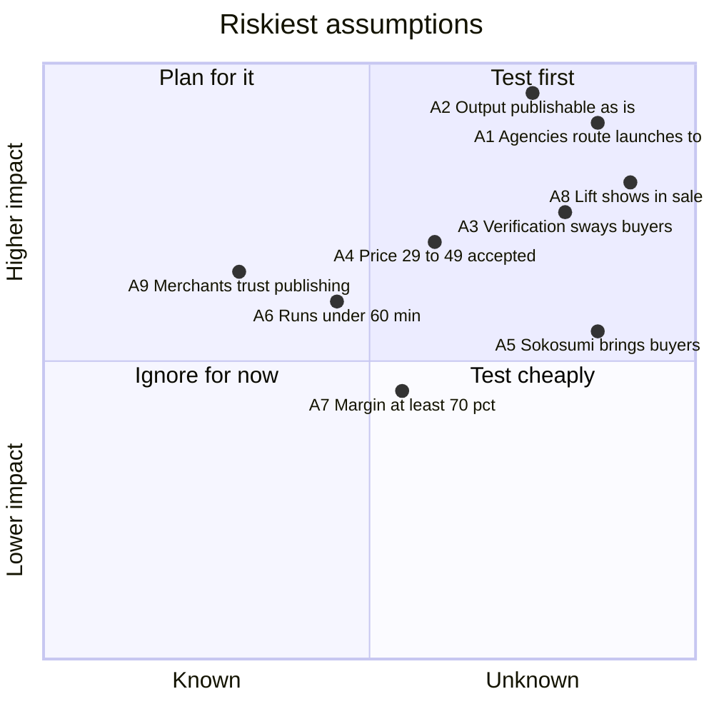

# Uplift Product-Market Fit

Oct 7, 2026 · Companion to [Uplift_GTM_Plan.md](Uplift_GTM_Plan.md)

## Verdict

**The thesis:** agencies and brand e-commerce teams that launch products on Shopify will pay per launch for a verified AI growth team. Uplift turns one request into a researched, built and published listing, and charges only for work that passes an independent check.

**Where the evidence stands:** the problem side is strong. The work is expensive, frequent and risky, and merchants already pay apps and freelancers for it. The solution side is partial: the full pipeline is built and every deliverable is verified, but it has never run for a paying customer. The market side has no evidence yet: no paying customers, preprod payment rails, and run time and unit cost unmeasured.

Product-market fit is therefore a well-supported hypothesis, not a result. The plan below is built to prove or disprove it by **Dec 6, 2026 (day 60)**, using the thresholds in [How we'll know](#how-well-know-signals-and-thresholds).

| Fit dimension | Evidence today | Strength |
| --- | --- | --- |
| The problem is real and expensive | Freelance work costs about $300–$1,350 per product; small-store agency retainers run $2,000–$5,000/mo; 54% of shoppers abandoned a purchase over conflicting product info | Strong |
| Buyers already pay to solve it | 21,000+ Shopify apps and $1.3B paid to developers last year; SEO, translation and feed apps with thousands of reviews | Strong |
| Uplift's solution works | 12 specialists, orchestration, Chainlink verification and gated publishing are built and tested in simulation; never run for a real merchant | Partial |
| Uplift beats the alternatives | No competitor offers more than two of its seven differentiators; but Sidekick is free, and Uplift handles one product per Task | Partial |
| Buyers can be reached | Sokosumi's buyers are enterprise marketing teams; the Shopify App Store bars off-platform billing | Weak |
| Buyers pay our price | Untested | None |
| Buyers come back | Untested | None |

## PMF thesis

**Positioning statement:** for agencies and e-commerce teams that launch products on Shopify, Uplift is the verified AI growth team. It turns one request into a published, search-ready listing (copy, images, catalog and feed, languages, promotions and paused Google Ads) and charges only for work that passes an independent check. Single-purpose apps each do one piece and leave the stitching to the merchant. Freelancers take days and give no guarantee. Uplift delivers the whole launch behind one approval.

| Element | Statement |
| --- | --- |
| Beachhead customer | European agencies and brand e-commerce teams that launch a few hero products a month on Shopify, often into 2–3 EU languages |
| Later customer | Small merchants with 10–2,000 products, reached through a Shopify App Store app billed by Shopify, once catalog mode exists |
| Urgent problem | A launch or relaunch needs 5–7 tools or a freelancer chain, costs $300–$1,350 per product and takes days. Nobody guarantees the work is right, and a wrong claim on a live page is a brand risk |
| Trigger moments | A new product drop, a new market, Black Friday and other seasonal pushes, a product that stopped selling |
| Promise | One request, one approval, a published listing; pay only for verified work |
| What they use today | Freelancers and agencies; an app stack at $126–$552/mo; Shopify's free Sidekick; doing it themselves |
| Why now | AI shopping agents buy from structured product data: Agentic Storefronts and the Universal Commerce Protocol (Jan 2026), agent checkout (Sep 2026). Orders from AI search on Shopify rose 15x in 2025 |
| Hard-to-copy advantage | Independent verification with pay-for-pass and refunds, across 12 specialties, behind one approval. Single-function apps lack the breadth; Shopify is unlikely to have a third party verify its own AI |

## Problem evidence

| Pain | Figure | Source |
| --- | --- | --- |
| Freelance cost of one product launch (copy, 3 images, 2-locale translation, an hour of SEO) | About $300–$1,350 (estimate from the line items below) | Competitor research, Oct 2026 |
| Product photography | $50 per white-background image; lifestyle images from $95; $50–$350 per finished image | [Squareshot](https://www.squareshot.com/pricing), [Shopify blog](https://www.shopify.com/blog/product-photography-pricing) |
| Translation | $0.09–$0.25 per word | [Gengo](https://gengo.com/?p=2), [Translayte](https://translayte.com/blog/how-much-does-a-translator-cost-in-2024) |
| Google Ads setup | $800–$2,500 freelance; $1,200–$5,800 first-month agency setup | [ClicksGeek](https://clicksgeek.com/ppc-campaign-setup-cost/), [WebFX](https://www.webfx.com/ppc-pricing.html) |
| Agency retainers | $2,000–$5,000/mo for small stores | [Tenten](https://tenten.co/shopify/shopify-agency-pricing-2026/) |
| Bad product content loses sales | 54% abandoned a purchase over conflicting product info; 71% returned items over inaccurate descriptions | [Salsify](https://www.salsify.com/press-release-salsify-2025-consumer-research-report) (vendor survey) |
| Weak product pages are common | 62% of mobile product pages have mediocre or worse UX | [Baymard](https://baymard.com/research-articles/current-state-ecommerce-product-page-ux?r=0) |
| Language is a buying barrier | 76% prefer to buy in their own language; 40% never buy from sites in other languages | [CSA Research](https://csa-research.com/Blogs-Events/CSA-in-the-Media/Press-Releases/Consumers-Prefer-their-Own-Language) (2020) |

**Not yet known, and the first thing to learn:** how often the beachhead does this work. The plan assumes agencies launch or relaunch several products a month across their clients. If launches are rare, a per-task product can't build a habit, and fit fails on frequency even if the value is real.

## Value against alternatives

Uplift's prices are the test prices from the GTM plan. Times for today's alternatives are typical turnaround, not measured. Uplift's own time is a target until the timing logs report real runs.

| Job | What they use today | Cost today | Uplift price (test) | Uplift time (target) | Uplift's edge beyond price |
| --- | --- | --- | --- | --- | --- |
| Launch a hero product | Freelancers plus 3–5 apps | $300–$1,350 per product | $29–$49 | Under 60 min | Research-grounded copy, image fidelity check, feed, translations and paused Ads in one approval |
| Take a product into a new market | Translator or a translation app | $0.09–$0.25/word, or $12–$99/mo | $2 per locale | Under 15 min | Local keywords from real search data, published into Shopify translations |
| Fix a product that isn't selling | SEO freelancer or retainer | $75–$200/hr, or $500–$5,000/mo | $9–$12 | Under 30 min | Before/after listing score, competitor review mining, compliance check |
| Build Google Ads for a product | PPC freelancer or agency | $800–$5,000 setup | Included in a launch (Sasha lists at 1.50) | Under 60 min | Break-even bids from real margin, paused for review |
| Prepare a Black Friday push | Agency campaign work | $800–$5,000 | About $10–$20 (Marcus, Leo, Sasha) | Under 60 min | Margin-safe discount codes, email copy and an Ads plan together |

On price, Uplift is 10–40x cheaper than people for the same job list. **The fit question is not price. It is whether the output is good enough to publish with little editing.** That is what the edit-rate and first-pass thresholds below measure.

## Riskiest assumptions

Positions are the team's judgement, not data: higher means fit fails without it, and further right means less is known today.

| # | Assumption | Why it matters | Cheapest test | Pass mark |
| --- | --- | --- | --- | --- |
| A1 | Agencies and brand teams will route real launch work to an AI team | No demand, no business | 15 problem interviews, then 5 design partners | 10 of 15 do launches monthly or more; 4 of 5 partners ask for a second launch |
| A2 | Output is publishable with light edits | Cheap but unusable work does not repeat | Design-partner launches, measuring fields edited before approval | Under 20% of fields edited; 85% first-pass Chainlink rate |
| A3 | Independent verification is a reason to buy | It is the main defence against free Sidekick | Interviews plus an A/B landing page with and without the guarantee | Guarantee variant converts 25% better, or 8 of 15 interviewees rank it in their top two reasons |
| A4 | $29–$49 per launch is acceptable | Sets margin and positioning | Price A/B on Sokosumi templates and the landing page | $49 converts at least 70% as well as $29 |
| A5 | Sokosumi has buyers for this | The first channel | Count views, Task starts and buyers on production | 10 paying teams from Sokosumi by day 60 |
| A6 | A full launch can run in under 60 minutes | Long waits kill the "same day" promise | Timing logs on real runs, then the one-payment-per-Task change | Median under 60 min by day 60 |
| A7 | Gross margin stays at 70% or more | Price ceiling vs model and data-API cost | Log cost per Task beside the timing logs | 70% at the chosen price |
| A8 | A better listing score turns into traffic and sales | The long-term reason to come back | Before/after Google rank and sessions 30 days after publish | Half of published products gain rank or sessions |
| A9 | Merchants trust an AI team to publish to their store | Required for the full promise | Share of approved change sets that get published | 80% of approved change sets published |

## How we'll know: signals and thresholds

Fit is declared only when the leading signals and at least one lagging signal clear their bars for the same cohort. Apart from the Sean Ellis benchmark, these thresholds are targets the team sets, not industry standards.

| Signal | Type | How it's measured | PMF threshold |
| --- | --- | --- | --- |
| Sean Ellis test: “How would you feel if you could no longer use Uplift?” | Leading | Survey every team after its second Task | 40% or more answer “very disappointed”. That is Ellis's benchmark; Superhuman went from 22% to 58% while working on fit ([First Round](https://review.firstround.com/how-superhuman-built-an-engine-to-find-product-market-fit/)) |
| Repeat purchase | Leading | Teams buying a second Task within 30 days | 40% or more |
| Agency depth | Leading | Tasks per agency per month, month 2 | 4 or more |
| Edit rate | Leading | Share of changed fields the buyer edits before approving | Under 20% |
| First-pass rate | Leading | Deliverables passing Chainlink on the first attempt | 85% or more |
| Pull | Leading | New teams from referral or word of mouth | 30% or more of new teams in month 2 |
| Retention curve | Lagging | Active teams in month 2 relative to month 1, by cohort | 50% or more, and flattening |
| Outcome | Lagging | Median listing-score change; Google rank and sessions 30 days after publish | +20 points; half of products gain rank or sessions |
| Unit economics | Lagging | Gross margin per Task at the chosen price | 70% or more |

**Segment before judging.** Run the Sean Ellis survey per segment (agencies, brand teams, small merchants) and per job (launch, new market, fix). As Superhuman did, find the segment that is already above 40% and build for it. Don't average a strong segment away with a weak one.

## 60-day PMF sprint

Day 1 is Oct 8, 2026. Each step has a pass mark. A failed step moves straight to [Pivot triggers](#pivot-triggers).

1. **Problem interviews (Oct 8–21).** 15 agencies and brand teams, starting with Serviceplan's network and the Shopify Partner Directory. Learn launch frequency, current cost and turnaround, and what "verified" would need to mean for them. Pass: A1 frequency and A3 ranking marks.
2. **Concierge design partners (Oct 15 – Nov 6).** Five teams run real launches free or at cost, with the founders watching every run. Measure edit rate, first-pass rate, time and cost per Task. Pass: A2, A6 baseline and A7 baseline marks; 4 of 5 ask for more.
3. **Ship the one-payment Task (by Nov 6).** Implement spec §8.1 so Nora takes one payment per Task instead of one escrow per specialist. This is the change most likely to move run time.
4. **Price and guarantee tests (Nov 1–30).** A/B $29 vs $49 and with/without the guarantee, on Sokosumi templates and a landing page. Pass: A3 and A4 marks.
5. **Free listing score (live by Nov 13).** A public page that scores one product and ends in a quote. Pass: 5% of scored stores buy within 14 days.
6. **Black Friday pack (Nov 13–27).** A timed offer for the season's most urgent job; tests whether urgency lifts conversion and repeat purchase.
7. **App Store fake door (Nov 13 – Dec 6).** A waitlist for "Uplift for Shopify" on the landing page, to size small-merchant pull before building the Shopify Billing app.
8. **PMF review (Dec 6).** Sean Ellis survey per segment, repeat rate, outcome data from the earliest launches (30 days after publish), margin. Decide: double down on the winning segment, or pivot.

## Product changes that raise the odds of fit

Ranked by expected effect on the riskiest assumptions; all are grounded in the current codebase.

| Change | Assumptions it helps | Why |
| --- | --- | --- |
| One payment per Nora Task (spec §8.1) | A6, A7 | Today each specialist is a separate escrowed Job, so a full launch waits on 7–8 Cardano escrows plus Sokosumi's once-a-minute sync |
| Cost per Task logging beside the timing logs | A7, A4 | Prices can't be set safely without it |
| Edit-before-approve on the change set | A2, A9 | Lets buyers fix a field instead of rejecting the whole set, and measures edit rate directly |
| 30-day outcome report (Quinn re-runs automatically) | A8 | Turns "better score" into "more traffic", the evidence that drives repeat purchase |
| White-label launch pack | A1 | Agencies resell under their own name |
| Catalog mode (shared research per collection, per-product fixes) | A1, later the small-merchant segment | Uplift works on one product per Task today |
| Yuki translates alt text and FAQs, as the spec promises | A2 | Closes a gap between spec and code for the new-market job |

## Pivot triggers

| If by day 60… | Then |
| --- | --- |
| Interviews show launches are rare (under monthly) | Reposition around the frequent job (catalog refresh or new markets) and build catalog mode first |
| Edit rate stays above 40% | Narrow the scope to the specialists with the best first-pass rates (likely research, copy and translation) and make the rest optional |
| Buyers like the output but don't value verification | Sell on speed and completeness; keep verification as quality control, not the headline |
| Buyers ignore verification, but other agent builders want it | Pivot the Chainlink verify-and-gate workflow into a verification layer for agent marketplaces such as Sokosumi and Masumi vendors. Chainlink already promotes AI-agent use of CRE ([launch post](https://chain.link/blog/chainlink-runtime-environment-now-live)) |
| Sokosumi brings under 3 paying teams | Go direct: agency sales plus the Shopify App Store app with Shopify Billing, moved up from phase 3 |
| Gross margin is below 50% at $49 | Cut the costliest steps from the default plan (review scraping, image generation) or raise prices for the full launch |
| The free listing score converts but launches don't | Productize the audit (a per-store subscription) and sell launches as an upsell |

## Sources

All pages opened on or before 2026-10-07. Product facts come from the Uplift codebase and the specs in this folder; market and competitor facts are detailed with their sources in [Uplift_GTM_Plan.md](Uplift_GTM_Plan.md).

- PMF benchmark: [How Superhuman Built an Engine to Find Product Market Fit](https://review.firstround.com/how-superhuman-built-an-engine-to-find-product-market-fit/) (First Round Review)
- Costs: [Squareshot](https://www.squareshot.com/pricing) · [Shopify photography pricing](https://www.shopify.com/blog/product-photography-pricing) · [Gengo](https://gengo.com/?p=2) · [Translayte](https://translayte.com/blog/how-much-does-a-translator-cost-in-2024) · [ClicksGeek](https://clicksgeek.com/ppc-campaign-setup-cost/) · [WebFX PPC pricing](https://www.webfx.com/ppc-pricing.html) · [Tenten agency pricing](https://tenten.co/shopify/shopify-agency-pricing-2026/)
- Shopper behaviour: [Salsify](https://www.salsify.com/press-release-salsify-2025-consumer-research-report) · [Baymard](https://baymard.com/research-articles/current-state-ecommerce-product-page-ux?r=0) · [CSA Research](https://csa-research.com/Blogs-Events/CSA-in-the-Media/Press-Releases/Consumers-Prefer-their-Own-Language)
- Market and why now: [Shopify 10-K FY2025](https://www.sec.gov/Archives/edgar/data/1594805/000159480526000007/shop-20251231.htm) · [Shopify News, billion-dollar ecosystem](https://www.shopify.com/news/billion-dollar-ecosystem) · [Shopify News, AI commerce at scale](https://www.shopify.com/news/ai-commerce-at-scale) · [TechCrunch, agent checkout](https://techcrunch.com/2026/09/28/shopify-opens-checkout-to-browser-based-ai-agents/) · [Digital Commerce 360](https://www.digitalcommerce360.com/2026/02/17/shopify-revenue-gmv-q4-2025/)
- Channels and verification: [Sokosumi](https://www.sokosumi.com) · [Shopify App Store requirements](https://shopify.dev/docs/apps/launch/shopify-app-store/app-store-requirements) · [Chainlink CRE launch](https://chain.link/blog/chainlink-runtime-environment-now-live)
